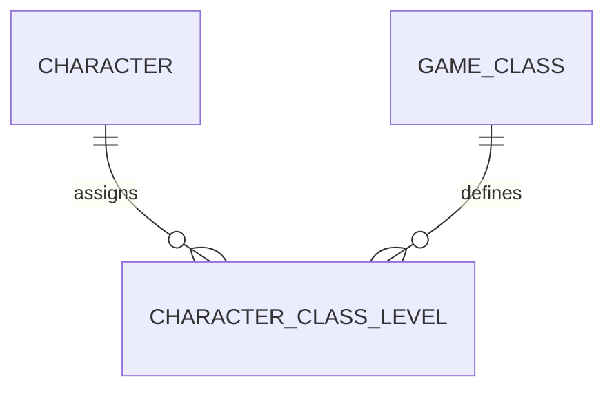
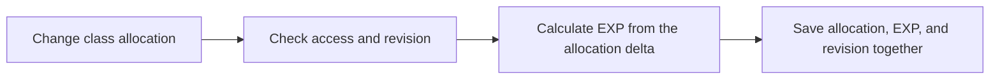

# Task Tech

Read the task UX when available, plus relevant implementation, tests, and architecture guidance. Follow the real entry points and carry forward agreed behavior. Keep sequencing in the implementation plan.

Write `docs/tasks/<task>/tech.md` and link it from the task summary. Keep it focused on the decisions needed to build the feature.

- **Production boundary** names the affected modules, entry points, and reusable prototype components. For UI work, connect each changed screen to production data, permissions, and persistence. Adapt prototype data types where needed to align with the production contract.
- **Data and flows** show meaningful relationships or mutations in fenced Mermaid blocks. Use an ER diagram for changed persistent entities, a flowchart for ownership and data paths, and a sequence diagram where ordering across components matters. Put invariants, compatibility, and failure cases next to the flow they affect.
- **Database changes** define the schema, constraints, indexes, migrations, and runtime-role grants needed for changed persistence. Explain how existing data is preserved or backfilled and specify necessary seed updates. Document reproducible local migration and seed commands, clearly identifying destructive resets and the appropriate migration and application roles. Keep database preparation decisions here; the handover records verification against this design after implementation.
- **API contract** links a machine-readable OpenAPI 3.1 `openapi.yaml` beside `tech.md` for HTTP changes. Cover changed operations, schemas, authorization, and errors. Reuse canonical components and validate the task contract with the repository's existing tooling. For unchanged HTTP contracts, state that no schema update is needed.

Identify material choices still needing review. Use the [class management technical design](../../../docs/tasks/class-management/tech.md) as a worked example.

## Examples

### Data model



### Write flow



### OpenAPI request example

For the character PATCH, place the example next to the request schema.

```yaml
requestBody:
  required: true
  content:
    application/json:
      schema:
        type: object
        required: [expectedRevision, changes]
        properties:
          expectedRevision: { type: integer, minimum: 0 }
          changes: { $ref: "#/components/schemas/CharacterChanges" }
      examples:
        assignFirstClassLevel:
          summary: Assign one class level to a new character
          value:
            expectedRevision: 1
            changes:
              progression:
                classLevels:
                  - gameClassId: "3101c2bc-0316-47f8-b77a-a614170d7646"
                    level: 1
```
