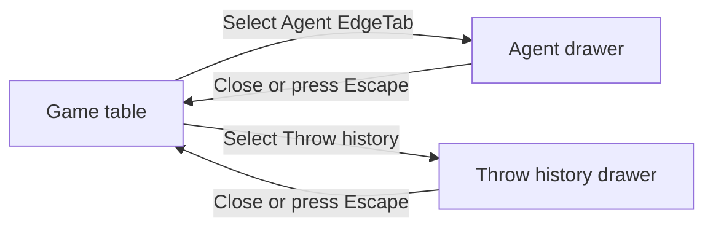
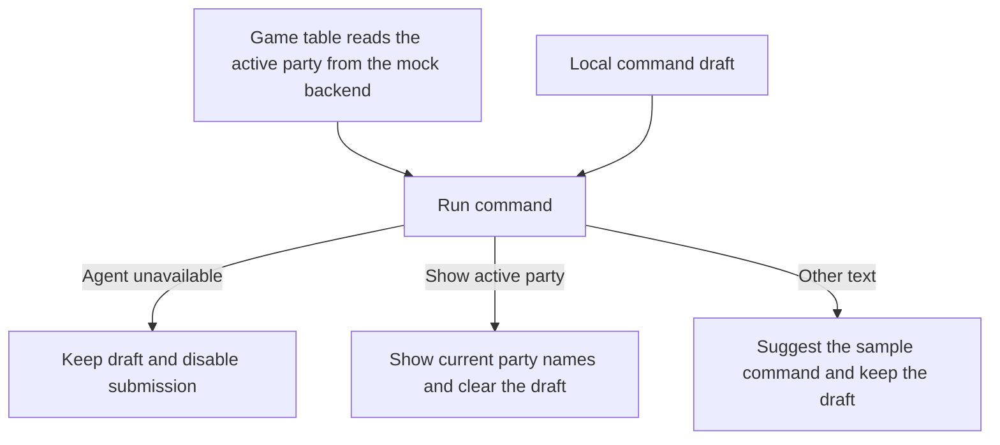

# Agent on the game table

## Domain language

- **Agent EdgeTab** opens the Agent drawer from the right edge of the game table, alongside the existing table drawers.
- **Command** is a request typed by a GM or player for the agent to act on the current game.
- **Result** tells the user what the command returned or what to try next.

## Actions by role

| Role   | Action                                                              | Screen or control                           | Scope                             |
| ------ | ------------------------------------------------------------------- | ------------------------------------------- | --------------------------------- |
| GM     | Open and close Agent                                                | Game table, Agent EdgeTab                   | Prototype                         |
| GM     | Enter and run a sample command                                      | Agent drawer, Command field and Run command | Prototype, reads the active party |
| GM     | Keep editing when Agent is unavailable                              | Agent drawer, Command field                 | Prototype                         |
| Player | Ask about the party and NPCs visible on the player table            | Agent drawer                                | Planned                           |
| GM     | Ask about the party and NPCs on the GM table, including hidden NPCs | Agent drawer                                | Planned                           |
| GM     | Edit an NPC profile                                                 | Agent drawer                                | Planned                           |
| Player | Roll, reroll, and edit permitted character profiles                 | Agent drawer                                | Planned                           |

## What the agent can see

Every command starts with basic party and NPC information from the caller’s table view. The agent looks up character and NPC profile details when needed. Player commands use the player’s view, including only the NPCs and details visible to that player. GM commands use the GM’s view, including hidden NPCs and GM notes when relevant. Both roles can ask about public throws and their own private throws.

The class library and game class management are outside the Agent drawer’s scope.

## Screen map

## Data flows

## Prototype

Run `pnpm --filter @rpg-engine/frontend prototypes:dev` and open **Prototypes / Agent on the game table**. In the [Histoire story](../../../packages/frontend/prototypes/ai-provider-configuration/AgentEdgeTab.story.vue), select **Agent**, choose **Show active party**, and run it. Turn off **Agent available** in the story controls to review the unavailable state. Close and reopen the drawer to review how it preserves the draft.

The prototype uses the existing [GameTable](../../../packages/frontend/src/modules/game-table/GameTable.vue) and [EdgeTabs](../../../packages/frontend/src/shared/design-system/base/EdgeTabs.vue). It uses the shared mock backend for game data and implements the sample command locally. The choice of sample command, drawer behavior, and draft lifetime are prototype decisions pending review.

## Verification

The built Histoire story opened and ran the sample command in Chromium at 1024 px and 360 px. The [browser test](../../../packages/frontend/prototypes/ai-provider-configuration/AgentEdgeTab.browser.ts) also covers unsupported commands, keyboard submission, preserving an unavailable draft across drawer changes, and reopening the existing Throw history drawer.
