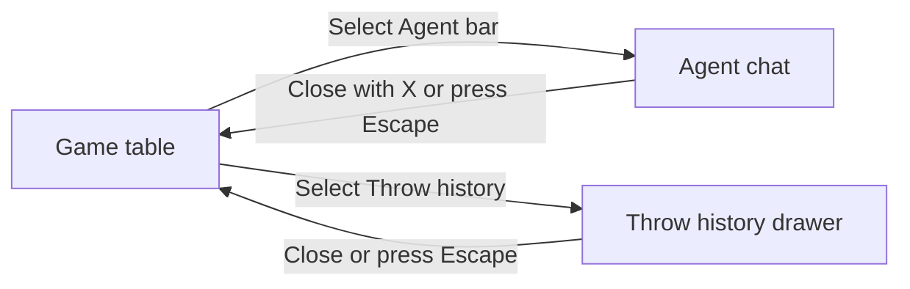
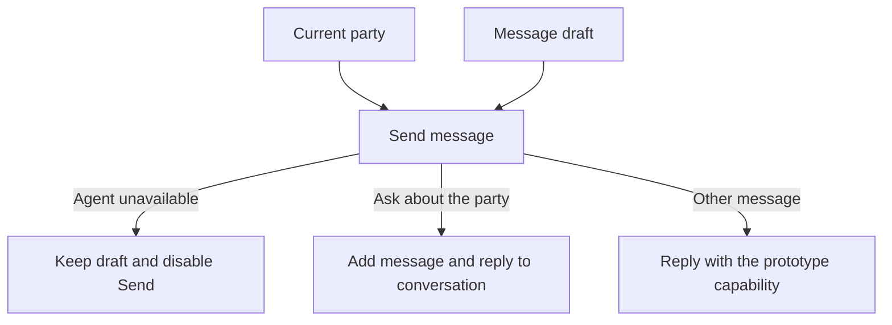

# Agent on the game table

## Domain language

- **Agent bar** sits minimized at the bottom-right corner of the game table. Selecting it opens a compact chat window in the bottom-right corner and hides the bar. The dark bar stays fixed to the viewport while scrolling. Closing the chat with X restores the bar and preserves the conversation and draft. The proposed size is 360 × 420 px, constrained to fit smaller viewports. The table remains available while chatting.
- **Message** is a conversational request typed by a GM or player about the current game.
- **Reply** is the agent’s response in the conversation.
- **Tool call** appears in the message history between the request and the agent’s reply.

## Actions by role

| Role   | Action                                                              | Screen or control                  | Scope                             |
| ------ | ------------------------------------------------------------------- | ---------------------------------- | --------------------------------- |
| GM     | Open and close Agent                                                | Game table, Agent bar              | Prototype                         |
| GM     | Enter and send a sample message                                     | Agent chat, Message field and Send | Prototype, reads the active party |
| GM     | Keep editing when Agent is unavailable                              | Agent chat, Message field          | Prototype                         |
| Player | Ask about the party and NPCs visible on the player table            | Agent chat                         | Planned                           |
| GM     | Ask about the party and NPCs on the GM table, including hidden NPCs | Agent chat                         | Planned                           |
| GM     | Edit an NPC profile                                                 | Agent chat                         | Planned                           |
| Player | Roll, reroll, and edit permitted character profiles                 | Agent chat                         | Planned                           |

## What the agent can see

Every message starts with basic party and NPC information from the caller’s table view. The agent looks up character and NPC profile details when needed. Player messages use the player’s view, including only the NPCs and details visible to that player. GM messages use the GM’s view, including hidden NPCs and GM notes when relevant. Both roles can ask about public throws and their own private throws.

The class library and game class management are outside the Agent chat’s scope.

## Screen map

## Data flows

## Prototype

Run `pnpm --filter @rpg-engine/frontend prototypes:dev` and open **Prototypes / Agent on the game table**. In the [Histoire story](../../../packages/frontend/prototypes/ai-provider-configuration/AgentEdgeTab.story.vue), select the bottom **Agent** bar, type **Who is in the party?**, and select **Send** or press Enter. Turn off **Agent available** in the story controls to review the unavailable state. Close and reopen the chat to review how it preserves the draft.

The prototype opens with a sample conversation showing a tool call. It uses the existing [GameTable](../../../packages/frontend/src/modules/game-table/GameTable.vue) and [EdgeTabs](../../../packages/frontend/src/shared/design-system/base/EdgeTabs.vue), with the shared mock backend for game data and locally simulated replies. The choice of sample conversation, chat window size, and draft lifetime are prototype decisions pending review.

## Verification

The compact chat was reviewed in Chromium at viewport widths of 793 px and 360 px. Its window measured 360 × 420 px and 336 × 420 px respectively. The [browser test](../../../packages/frontend/prototypes/ai-provider-configuration/AgentEdgeTab.browser.ts) also covers conversational replies, keyboard submission, preserving an unavailable draft across drawer changes, and reopening the existing Throw history drawer. Minimizing keeps the conversation and draft for the current prototype session.
