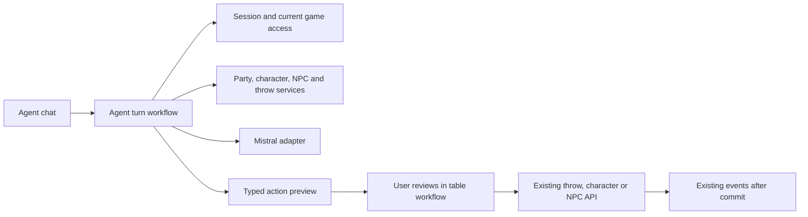
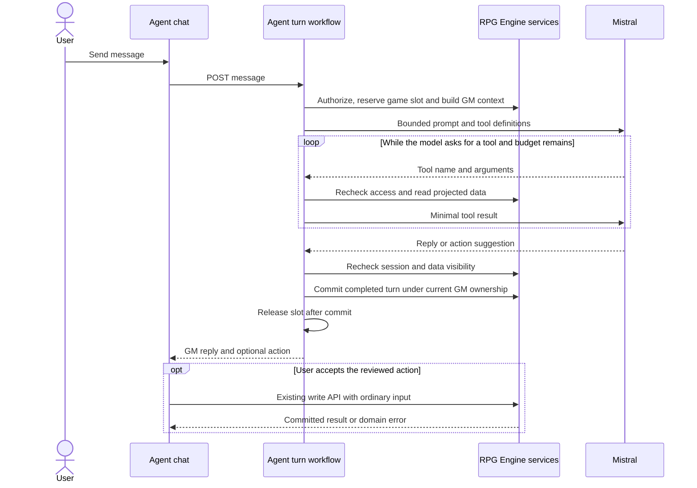
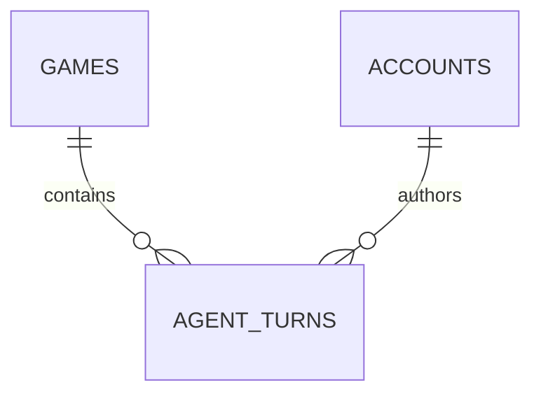

# AI provider configuration — technical design

**Implemented design** · [Agent UX and prototype](ux.md) · [Agent OpenAPI 3.1 contract](openapi.yaml)

## Production boundary

Use Mistral for language and tool selection. The RPG Engine backend supplies the GM’s table view and validates each proposed action. The browser submits a roll or save through the existing workflow after the user reviews it.

| Entry point        | Production connection                                                                                                                                                                                                                                                                                                                                                                                                                                                                                                                                                                                                |
| ------------------ | -------------------------------------------------------------------------------------------------------------------------------------------------------------------------------------------------------------------------------------------------------------------------------------------------------------------------------------------------------------------------------------------------------------------------------------------------------------------------------------------------------------------------------------------------------------------------------------------------------------------- |
| Agent bar and chat | Mount the Agent from the table branch of [GameView](../../../../packages/frontend/src/modules/games/GameView.vue). Reuse [GameTable](../../../../packages/frontend/src/modules/game-table/GameTable.vue)’s launcher, compact slideover and shared drawer state for the GM. Use the production [AgentPanel](../../../../packages/frontend/src/modules/agent/AgentPanel.vue) presentation component in both the table and the prototype. Keep the story wrapper and sample conversation in the prototype.                                                                                                              |
| Agent controller   | Keep the draft and request state outside the slideover so minimizing preserves them. Read the GM transcript from the server. Scope local state to the mounted table, account and role. Clear them on table exit or account or role change and discard late responses. Use stable message IDs and typed tool summaries in place of the prototype’s array-index keys and mock messages. Inject the Agent client through [API services](../../../../packages/frontend/src/shared/api-services.ts), assembled in [main.ts](../../../../packages/frontend/src/main.ts). Send user text and load game facts on the server. |
| Agent API          | Add a backend `modules/agent` controller, request schemas and tool registry. Put cross-module turn orchestration in `application/agent-turn.ts`. Wire auth, game access, owner services and one provider adapter in [app.ts](../../../../packages/backend/src/app.ts). Inject the adapter for tests and normalize provider messages, tool call IDs, arguments and failures at its boundary.                                                                                                                                                                                                                          |



## Provider configuration

Use server-only `AGENT_ENABLED` (default false), `MISTRAL_API_KEY` and `MISTRAL_MODEL` in the existing startup configuration. Require a key when enabled and set the launch deployment to `MISTRAL_MODEL=mistral-small-2603`. Validate config shape at boot and verify tool calling for the selected model and credentials with synthetic input before enabling it for real games. Rotate the key or change the model through deployment configuration and restart. Use the official Mistral HTTPS origin and stateless Chat Completions, with parallel tool calls disabled and tool results linked to their provider call IDs. Keep credentials in the deployment secret store. [Mistral Chat Completions](https://docs.mistral.ai/inference/conversations/chat-completion) · [Mistral function calling](https://docs.mistral.ai/inference/conversations/function-calling)

Treat user messages and projected game text as data sent to a third party. Send only the fields needed for the turn. Enable training opt-out and verify retention for the actual Mistral account before enabling it for real games. The GM-only audience rules below also govern which records may enter a provider request. [Mistral data retention](https://docs.mistral.ai/admin/monitor-comply/zero-data-retention) · [Mistral training preferences](https://help.mistral.ai/en/articles/455207-can-i-opt-out-of-my-input-or-output-data-being-used-for-training)

## GM-only audience

Mount the Agent and fetch its status only for the game’s GM. Both Agent endpoints must authenticate the session and verify current GM ownership before returning history, reserving capacity or contacting Mistral. Return 403 to a player in the game and the existing 404 to an account without game access. Keep Agent messages, summaries and proposals off the game event stream.

## Authorized turn

Each turn starts with basic party and NPC information from the GM’s current table view. Use turn-scoped references for targets and expand profiles only when needed.

| Context or tool | Production authority and projection                                                                                                                                                                                                                                                                                                                                                                                                                                                                                                 |
| --------------- | ----------------------------------------------------------------------------------------------------------------------------------------------------------------------------------------------------------------------------------------------------------------------------------------------------------------------------------------------------------------------------------------------------------------------------------------------------------------------------------------------------------------------------------- |
| Active party    | `CharactersService.listActiveParty` supplies active members. Include name and reference. Resolve details only for an eligible member of that table view, then use `getWorkspaceCharacter` and project the requested GM-visible sheet fields. For skill advice, include manual skill names and notes plus the names, ranks, descriptions and benefits of skills this character has learned. Resolve learned definitions through the character’s game-scoped skill rank join. Keep unrelated class definitions out of the projection. |
| NPCs            | Use the existing GM projection from NpcsService.read. Include hidden NPCs in basic identities and relationships. Fetch profile details and GM notes when relevant.                                                                                                                                                                                                                                                                                                                                                                  |
| Throw history   | Use `ThrowsService.listThrows` for capped, filtered history. Use its existing public-or-authored-by-caller filter before pagination. Other accounts’ private throws remain inaccessible to the GM. Preserve this rule for prior-roll questions and reroll targets.                                                                                                                                                                                                                                                                  |
| Tool dispatch   | Match name and arguments against a fixed registry and validate with Ajv. Explicitly project outputs and treat all tool arguments and game text as untrusted data. The server derives actor, game and allowed targets. Lookups for unknown, cross-game or hidden targets give the model the same generic miss. The registry excludes generic HTTP, database and class-catalog access.                                                                                                                                                |



- Recheck session and GM ownership before outbound requests and before returning the answer. Revalidate the visibility of records and fields used in the turn, including NPC visibility, active party scope and throw visibility. Discard the turn if access narrows. Release database transactions before provider calls.
- Scope each transcript to the game and GM account. Persist completed turns in PostgreSQL across sessions and backend restarts. The current GM can read their completed turns, including author, message, tool summaries and reply. Keep action proposals private to the submitting account. Show the same history across the GM’s sessions. The server selects recent user messages from this GM’s game history and rebuilds current facts for follow-ups.
- On open, reconnect and while the panel is visible, fetch the authorized status snapshot (poll every two seconds while open). Open on the latest page with the newest message at the bottom. Merge refreshed turns by stable ID. On reaching the top, fetch the exclusive older page and prepend it. After rendering, restore the first visible message and its pixel offset. Allow one older-page request at a time, keep the cursor on failure and stop when nextBefore is null. Only follow new replies automatically while at the bottom. On reconnect, bridge any gap from the newest page back to a known turn before merging. While a turn is active, the GM can type and Send is disabled. Concurrent POSTs race on the server even if both clients saw an idle snapshot.
- After authentication and GM ownership checks, synchronously reserve the game and process slots before provider work. Reject a competing turn in the same game with 409 `agent_game_busy`; reject global saturation or an exceeded account rate with 429. Remove a rejected pending message and show an error toast. Preserve any new draft. Release both slots in a finally block on every exit. Commit the completed turn before returning success or releasing its slot. After a lost POST response, refresh history before a manual retry. Drop failed turns and discard late provider results after cancellation. Apply the agreed limits below across the entire turn. Abort on disconnect or shutdown. Log request ID, timing, token counts and error category. Exclude text, tool arguments, payloads and credentials.

## Rolls and profile edits

Alongside `read_character`, `read_npc` and `read_throws`, register three proposal tools. Each counts toward the ten-tool-call turn limit.

| Tool                     | Validated result                                                                                                                               |
| ------------------------ | ---------------------------------------------------------------------------------------------------------------------------------------------- |
| `prepare_throw`          | A roll setup and privacy choice for the GM to review. For a reroll, resolve the source from the GM’s visible throw history and include its ID. |
| `prepare_character_edit` | A character ID, the revision read by the server, and a diff of the requested sheet fields.                                                     |
| `prepare_npc_edit`       | An NPC ID, the revision read by the server, and a diff of the requested profile fields.                                                        |

Allow one action proposal per GM turn, including edits to hidden NPCs and rerolls from the GM’s authorized history. Resolve targets on the server and show the exact roll setup and privacy or the exact field changes for review. An explicit user action submits through the regular controller. Tool summaries describe completed reads and prepared actions. For example, show “Prepared character edit” when the diff is ready. The normal mutation response determines whether the UI reports success.

| Action         | Review and write path                                                                                                                                                                                                                                                                                                                                                                                                                                                                  |
| -------------- | -------------------------------------------------------------------------------------------------------------------------------------------------------------------------------------------------------------------------------------------------------------------------------------------------------------------------------------------------------------------------------------------------------------------------------------------------------------------------------------- |
| Roll or reroll | Show a compact roll preview with dice icons and submit through the existing create-throw client. Carry `sourceThrowId` for a reroll and apply the existing history and reroll rules. Resolve role-eligible targets from current data and show public/private before submission. The throw service applies active-character, source visibility and setup rules and generates dice on the server. The turn ID makes confirmations idempotent. Show the committed faces and total inline. |
| Character edit | Offer a diff from the authorized sheet for name, theme, level, base dice or current resources. Reuse the character editor’s revisioned save path with the captured revision. The service rechecks GM or controller permission and validates the merged sheet under the game lock. On a stale revision, fetch the latest sheet and require fresh review.                                                                                                                                |
| NPC edit       | Offer a GM-only diff for name, relationship, level, dice, resources, defenses or notes. Use the existing NPC editor for visibility and attack edits. Merge the approved changes into a complete `NpcWrite` using the reviewed revision and submit through the existing NPC editor queue. Preserve attacks and unrelated fields. If the editor has conflicting changes or the revision advanced, require fresh review before submitting.                                                |

Keep proposed changes outside autosave state until acceptance. Preserve existing editor drafts and send the reviewed revision rather than rebasing silently onto a newer version. Domain services check current permissions under the game lock and publish their usual post-commit events. Repeating a chat turn produces another reply or preview without repeating a game write.

### Skill advice

For “What skill can use Robert to make better shot?”, call `read_character` for Robert. Compare his recorded skills with the weapon and the requested improvement. Explain which learned skill helps accuracy, how it applies and any recorded cost or trigger. Distinguish an accuracy benefit from extra damage after a hit. Identify passive bonuses already included in his current dice. If weapon choice changes the answer, ask which weapon he is firing. If no description establishes a benefit, say so. This advisory turn produces a reply without preparing a roll or editing the sheet.

### Launch roll prompts

Use these utterances as acceptance cases for `prepare_throw`. Resolve names against the current game and weapons against the resolved actor’s sheet. Ask one targeted question when there are multiple plausible matches. Build the canonical setup from the resolved records and show it in the inline roll card. Tests should assert the selected IDs, setup and visibility, independent of the model’s reply wording.

| GM message                                            | Expected preparation                                                                                                                                                                                                                                                                                                                                                                                                                                                                                                                    |
| ----------------------------------------------------- | --------------------------------------------------------------------------------------------------------------------------------------------------------------------------------------------------------------------------------------------------------------------------------------------------------------------------------------------------------------------------------------------------------------------------------------------------------------------------------------------------------------------------------------- |
| “Robert attacks Agile with hammer”                    | Resolve Robert as the attacker, Agile as the target, and the hammer as Robert’s weapon. Prepare a weapon accuracy roll using the hammer’s saved accuracy pair and bonus, Robert’s current dice and sheet revision. Show Agile as the target in the preview. The current weapon throw stores a note and resolves accuracy only. Leave damage and HP changes to the GM. Keep hidden target names and GM notes out of public throw records, including the note. If the hammer lacks its accuracy setup, identify the missing sheet fields. |
| “Christine make check roll for agility when tumbling” | Resolve Christine and interpret agility as DEX. Propose DEX + DEX using her current DEX die twice, with “Tumbling” as the note. Show the pair for GM review. This is a suggested interpretation of the wording. An explicit second attribute overrides the suggestion. Report the roll total when the GM supplies no difficulty.                                                                                                                                                                                                        |
| “Make 2x10d roll”                                     | Interpret this shorthand as one free roll of two independent ten-sided dice. Preview “GM rolls 2d10” with dice `[10, 10]`, attribution `gm`, modifier 0 and no opposing dice. The throw service generates both faces and their sum after confirmation.                                                                                                                                                                                                                                                                                  |

The system prompt states the GM assistant’s purpose and describes when to use each of its six tools. Recent GM messages and the latest Agent reply provide follow-up context. Known damage and healing use edit tools. The server applies NPC HP deltas to the current profile within its HP bounds.

## Database and API contract

Use the existing game, profile, throw and `sign_in_attempts` tables with a distinct Agent rate policy key. Add a journaled migration and aligned Drizzle definition for `agent_turns`, owned by the Agent module. Existing games start with empty history. Existing demo seeds need no changes.



Store one immutable row per completed turn: UUID primary key, unique bigint identity sequence, game and GM account UUID foreign keys with cascading deletion, author display name, trimmed message (1–2,000 characters), reply (1–6,000 characters), and ordered tool summaries (JSONB array, at most ten entries, schema-validated by Agent). Make every column required. Keep raw tool data and executable proposals out of history. Migration 013 adds a unique nullable throw-to-turn link. The GM history includes the linked outcome for visible, nondeleted throws. In a short transaction, lock the game, recheck GM ownership and insert the entire turn. Grant runtime SELECT and INSERT on the table and USAGE on its identity sequence in the grants script.

Index (game_id, gm_account_id, sequence DESC). The status GET returns 20 completed turns by default (maximum 50). Resolve its optional `before` UUID within the same authorized transcript, then read rows strictly below that sequence, newest first, with limit + 1. Drop the extra row, reverse the page for display and return the oldest included UUID as `nextBefore` only when older rows exist. An unknown or inaccessible anchor yields 404. Paging whole turns keeps each question, tool summaries and reply together.

The checked-in [runtime grants](../../../../packages/backend/scripts/runtime-grants.sql) cover rate counters and throws but omit the existing NPC tables. Fix that script when implementing the Agent so a least-privilege runtime can use the existing NPC module. Grant `SELECT, INSERT, UPDATE, DELETE` on `npcs`, `SELECT, INSERT, DELETE` on `npc_attacks`, and `SELECT, INSERT` on `npc_create_requests`. Verify Agent reads and the existing NPC update with attacks as the runtime role.

For a fresh local database, migrate and apply grants as the schema owner. Set `DATABASE_URL` for the demo seed only to the owner of the disposable local database, then use the separate runtime role for the backend.

```sh
pnpm --filter @rpg-engine/backend migrate
psql "$MIGRATION_DATABASE_URL" -v app_schema=public -v app_role=rpg_runtime -f packages/backend/scripts/runtime-grants.sql
DATABASE_URL="$MIGRATION_DATABASE_URL" pnpm seed:demo
```

The optional `DATABASE_URL="$MIGRATION_DATABASE_URL" pnpm seed:demo --reset` destroys and rebuilds the local `public` schema and all data in it. Use it only on a disposable loopback database and reapply runtime grants afterward. Use an injected fake provider in automated tests. [Database setup and roles](../../../../README.md)

The [task OpenAPI contract](openapi.yaml) defines authenticated status GET and turn POST routes under the game. POST uses the existing Origin and session-bound CSRF checks. Use `Cache-Control: no-store` for both routes. Existing NPC, character and throw HTTP contracts are reused. The [canonical OpenAPI](../../../../packages/backend/openapi/openapi.yaml) includes the Agent paths and schemas. [Schema parity tests](../../../../packages/backend/src/schema-contract.test.ts) compare the Ajv request schema to the published contract.

Use an injected provider to assert the data that would leave the server across GM, player and non-member cases. Assert player requests to both endpoints return 403 without revealing history or contacting the provider. Race two GM sessions in the same game, verify slot release after timeout and verify another game can proceed. Cover hidden and visible-only NPCs, private throws, mid-turn revocation, tool validation and failures. Verify persisted history after restart, exclusive cursors with a concurrent append, empty and final pages, and cross-game cursor rejection. Cover scroll-to-top loading, deduplication and viewport anchoring in the browser. Extend browser coverage to the injected client and write review while preserving the existing keyboard, drawer and draft checks. Exercise authorization bypasses and persisted effects in API integration tests. [Testing conventions](../../../spec/testing.md)

## Launch model and agreed usage limits

The agreed launch model is Mistral Small 4, pinned to `mistral-small-2603`. Its function calling and structured outputs fit the narrow tool registry. Verify tool selection, argument accuracy and latency on representative table commands before launch. [Mistral model card and pricing](https://docs.mistral.ai/models/mistral-small-4-0-26-03)

| Scope                        | Agreed limit                                                                                                                                                                                  |
| ---------------------------- | --------------------------------------------------------------------------------------------------------------------------------------------------------------------------------------------- |
| One turn                     | 10 seconds total from admission, up to 20 model calls and 10 sequential tool calls. Stop at the first limit reached.                                                                          |
| Tokens across the whole turn | 20,000 input tokens including repeated context and tool schemas, and 2,000 output tokens including tool arguments. Check remaining allowance before each call and reserve room for the reply. |
| Per account                  | Six admitted turns per minute across games and sessions                                                                                                                                       |
| Per game                     | One active GM turn across tabs and sessions                                                                                                                                                   |
| Single backend process       | Ten turns in flight. Reject excess requests with the existing 429 and Retry-After behavior.                                                                                                   |

At the published prices of $0.15 per million input tokens and $0.60 per million output tokens, 1,000 turns consuming both full token allowances would cost about $4.20 in model usage.

## Release decisions

- Approve deployment-wide enablement. Confirm the provider data policy.
- The implemented action review uses inline roll and profile cards. Verify changes to the editable field set and review flow against the [handover scenarios](handover.md).
