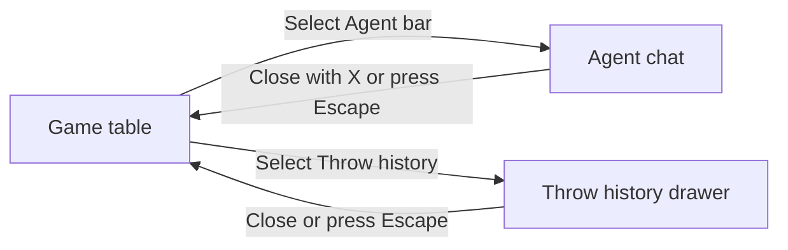

# Agent on the game table

## Domain language

- **Agent bar** sits minimized at the bottom-left corner of the game table. Selecting it opens a compact chat window in the bottom-left corner and hides the bar. The dark bar stays fixed to the viewport while scrolling. Closing the chat with X restores the bar and preserves the conversation and draft. The panel size is 360 × 420 px, constrained to fit smaller viewports. The table remains available while chatting.
- **Message** is a conversational request typed by the GM about the current game.
- **Reply** is the agent’s response in the conversation.
- **Tool call** appears in the message history between the request and the agent’s reply.

## GM actions

- Ask about the current table, character sheets, learned skills, NPCs, and visible throws.
- Confirm a proposed roll using **Make a roll** in chat. The preview and result show dice icons. The result shows faces and totals and persists with the conversation.
- Review character and NPC changes in chat. Select **Accept edit** or **Cancel** on the card. A revision conflict refreshes the before and after values for another confirmation.

## What the agent can see

Only the GM sees the Agent launcher and conversation. Each turn starts with the active party and NPC identities on the GM table, including hidden NPCs. The Agent looks up profile details and GM notes when relevant. Throw history includes public throws and the GM’s own private throws.

The GM can ask which of a character’s learned skills would help with a specific action.

The class library and game class management are outside the Agent chat’s scope.

## Conversation history

Opening the chat loads the latest messages in chronological order and positions the newest at the bottom. Scrolling to the top loads older messages automatically and keeps the first visible message at the same screen position. New replies follow the bottom only when the GM is already there. Completed conversations survive reopening the table and restarting the backend.

## Screen map

## Sending messages

Sending immediately adds the message to the conversation and clears the input. A failed send removes the pending message and shows an error toast. Text entered afterward stays in the input. If the Agent is unavailable before sending, the disabled Send control preserves the draft.

## Prototype

Run `pnpm --filter @rpg-engine/frontend prototypes:dev` and open **Prototypes / Agent on the game table**. In the [Histoire story](../../../../packages/frontend/prototypes/ai-provider-configuration/AgentEdgeTab.story.vue), select the bottom **Agent** bar, type **Who is in the party?**, and select **Send** or press Enter. Turn off **Agent available** in the story controls to review the unavailable state. Close and reopen the chat to review how it preserves the draft.

The prototype opens with a sample conversation showing a tool call. It uses the existing [GameTable](../../../../packages/frontend/src/modules/game-table/GameTable.vue) and [EdgeTabs](../../../../packages/frontend/src/shared/design-system/base/EdgeTabs.vue), with the shared mock backend for game data and locally simulated replies. The choice of sample conversation, chat window size, and draft lifetime are prototype decisions pending review.

## Verification

The compact chat was reviewed in Chromium at viewport widths of 793 px and 360 px. Its window measured 360 × 420 px and 336 × 420 px respectively. The [browser test](../../../../packages/frontend/prototypes/ai-provider-configuration/AgentEdgeTab.browser.ts) also covers conversational replies, keyboard submission, preserving an unavailable draft across drawer changes, and reopening the existing Throw history drawer. Minimizing keeps the conversation and draft for the current prototype session.
