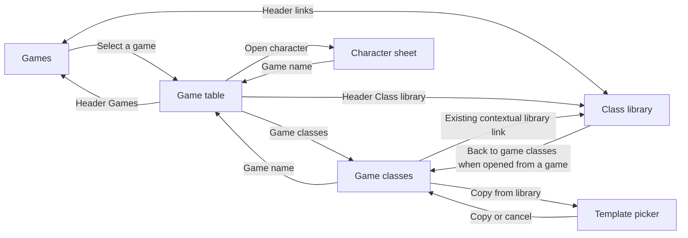
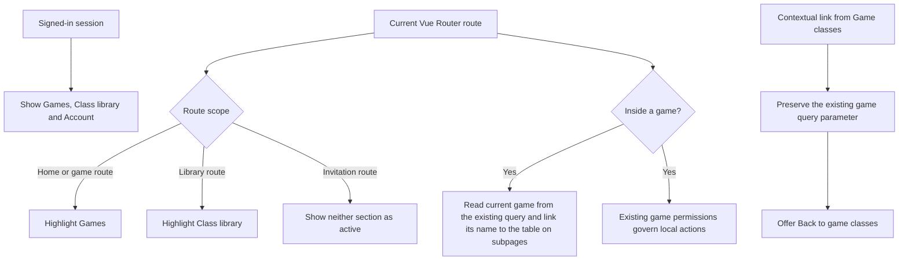

# App navigation

Status **Implemented**

The signed-in drawer lists Games and, on game routes, the current game. Class library has a separate entry beside Create game on the Games screen. That gives a cross-game destination the appearance of a page action and makes it hard to find from elsewhere. [App shell](../../../../packages/frontend/src/App.vue) · [Drawer links](../../../../packages/frontend/src/shared/components/PrimaryNavigation.vue) · [Games screen](../../../../packages/frontend/src/modules/games/GamesView.vue)

## Domain language

| Term          | Meaning                                                                                                                                |
| ------------- | -------------------------------------------------------------------------------------------------------------------------------------- |
| Games         | The signed-in user's game list and entry point to individual games.                                                                    |
| Class library | The account's reusable Fabula Ultima class templates, available outside any game. Use the full name while Classes is the only catalog. |
| Game classes  | Class definitions belonging to a specific game.                                                                                        |
| Account menu  | The signed-in username and account actions.                                                                                            |

## Actions by role

| Role       | Action                        | Screen or control                    | Scope                         |
| ---------- | ----------------------------- | ------------------------------------ | ----------------------------- |
| GM, player | Browse games                  | Header → **Games**                   | Signed-in account             |
| GM, player | Open the class library        | Header → **Class library**           | Signed-in account             |
| GM, player | Return to the current game    | Game name in the game page context   | Current game and its subpages |
| GM, player | Sign out                      | Header → **Account** → **Sign out**  | Signed-in session             |
| GM         | Copy a template into the game | Game classes → **Copy from library** | Current game                  |

Access follows the existing routes and permissions. Broader changes to game-local navigation are deferred.

## Screen map

## Data flows

## Screen design

- **Wide and tablet.** Put Games and Class library beside RPG Engine in the signed-in header, with Account to the right. Use an underline and stronger label for the active section. At the reported 728 px width, both destinations should fit on one row.
- **Phone.** Move both labeled links onto a second header row when available space runs out. Keep Account in the top row. Prototype this down to 320 px before choosing the final breakpoint.
- **Page actions.** Keep Create game on Games and Create class in Class library. Remove the Games page's Class library button and the standalone library's My games shortcut once both destinations are in the header. Preserve the existing contextual return link when entering the library from a game's classes.
- **Inside a game.** Keep Games visually active on the table, game classes and character pages. Put the current game's name and return link in page context. Keep game-specific controls there, including Copy from library for the GM. Set `aria-current="page"` only when the link points to the current page.
- **Nuxt UI.** Use the installed `UNavigationMenu` with `to` links and Vue Router-derived active states inside the existing shell. `UHeader` is an option if its layout is customized. Its default theme hides the center slot below `lg`. Use `UDropdownMenu` for account actions. [Nuxt UI Header](https://ui.nuxt.com/docs/components/header) · [NavigationMenu](https://ui.nuxt.com/docs/components/navigation-menu) · [DropdownMenu](https://ui.nuxt.com/docs/components/dropdown-menu)

## Pattern comparison

- **Visible header links (preferred).** Two short, peer destinations fit a simple header. Keeping both exposed also avoids asking users to open a menu just to see that the library exists. [USWDS header guidance](https://designsystem.digital.gov/components/header/) · [Nielsen Norman Group usability study](https://www.nngroup.com/articles/hamburger-menus/)
- **Persistent sidebar.** Gives a larger collection of destinations room for grouping. Its permanent width would compete with the game table and character sheets today. [Nuxt UI DashboardSidebar](https://ui.nuxt.com/docs/components/dashboard-sidebar)
- **Drawer with Class library added.** Fixes the missing entry with the smallest change. Discovering either destination still takes opening the menu.

## Verification for implementation

Use the responsive header concept to check whether a GM or player can find Class library from Games, the game table and a character sheet. Check the one-row layout at 728 px and the two-row layout at 320 px, keyboard focus and current-section indication, direct links and browser Back, the game classes → class library → game classes round trip, and Sign out. The proposal's layout and labels have no user-test evidence yet.
