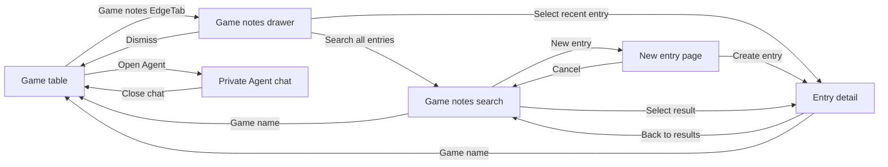
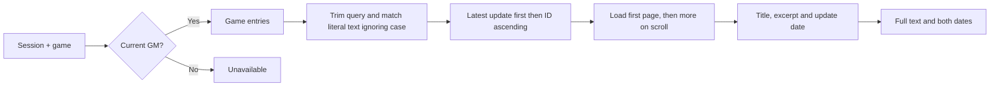
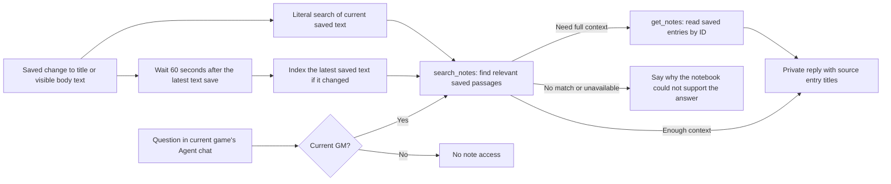

# Game notes — UX and prototype

[Technical design](tech.md)

## Domain language

**Game notes** is one game's private GM notebook. An **entry** has a plain-text title and a rich-text body. Created records when the entry was first saved. Updated records its most recent text or formatting change. The current GM owns access through the game. Game notes are distinct from character sheet notes and throw annotations.

The **Agent** can use saved entries as reference when the GM asks a question in the current game's private chat. Planned retrieval-augmented generation (RAG) finds relevant passages by meaning, not just by exact words. **Search all entries** remains a literal text search.

The [provisional GM persona](../../../research/personas/game-master.md) describes a GM keeping play moving. A table drawer gives the GM quick access to recent entries during play. This is a design assumption from simulated research. GM-only visibility and per-game search are product assumptions for review.

## Actions by role

| Role   | Action                           | Screen or control                                    | Scope                                                      |
| ------ | -------------------------------- | ---------------------------------------------------- | ---------------------------------------------------------- |
| GM     | Capture an entry                 | New entry on the notes screen                        | Current game                                               |
| GM     | Browse entries newest first      | Game notes EdgeTab opens a drawer over the table     | Current game; load older entries on scroll                 |
| GM     | Search the notebook              | Search all entries in the drawer                     | All titles and content in this game                        |
| GM     | Read or revise an entry          | Select a result, edit Title or Content               | Selected entry                                             |
| GM     | Ask the Agent about the notebook | Existing Agent chat on the game table                | Read-only retrieval from saved entries in the current game |
| GM     | Resume play                      | Close the table drawer or follow the named game link | Return to the same table                                   |
| Player | Play at the table                | Existing table controls                              | GM notes and their contents are private                    |
| GM     | Share or delete entries          | Deferred                                             | Outside this task                                          |

## Screen map



## Data flows





```mermaid
sequenceDiagram
  actor GM
  participant View as Game notes
  participant Store as Game entries
  GM->>View: Enter title and content
  GM->>View: Create entry
  alt Missing title
    View-->>GM: Toast and editable draft
  else Valid
    View->>Store: Create once with stable entry ID
    Store-->>View: Entry and both timestamps
    View-->>GM: Toast and open entry detail
  end
  GM->>View: Edit an existing field
  View-->>GM: Show changes immediately
  Note over View: Wait 2 seconds after the latest edit or flush on field exit
  View->>Store: Queue changed title or body at acknowledged revision
  alt Accepted
    Store-->>View: Updated entry and revision
    View-->>GM: Refresh results and metadata
  else Rejected or response uncertain
    View-->>GM: Toast with recovery; retain editable text
  end
```

## Screens and interactions

- **Table.** Keep the party and roll controls in place. The Game notes EdgeTab sits in the same right-edge rail as Character sheets, NPCs and Throw history. Selecting it slides the Game notes drawer in from the right and leaves only its active edge tab visible. Press Escape or use the close button to dismiss it and restore the rail. Show the newest entries first and load older entries as the GM scrolls the drawer. Each SurfaceCard shows its title, full content and both dates immediately. Select anywhere on a card to open that entry on the notes screen. Dismiss the drawer to resume play at the same position. Search all entries is an underlined ULink to the separate notes screen.
- **New entry.** The notes screen header opens a dedicated creation page. Creating an entry opens its detail. Cancel returns to the notes screen and preserves the draft for the same game. Title is required after trimming, up to 160 characters. Content may start empty and supports up to 5,000 text characters. Repeated titles are allowed. Reuse LabeledInput for the title, the Quill editor for the body, and FormActions for Create entry and Cancel. A failed request keeps the page and draft, including formatting. Disable the form only while submitting. Confirm success with a toast.
- **Formatting.** The toolbar offers Normal text and headings 1–3, bulleted and numbered lists, bold, italic, underline, strikethrough and Clear formatting. No colors, fonts, font sizes, links or media. Pasted content keeps only supported formatting and text. The drawer and results cards display supported formatting without an editor toolbar. Search matches only the title and visible body text, including across inline formatting boundaries.
- **Search.** Keep Games active in the signed-in header. Use the game name as the return link above Game notes. A blank query browses all entries, newest first. Search the full notebook, not just the entries already loaded. Changing the query starts a fresh result list. Click or tap anywhere on a search result card, or focus its title and press Enter, to open the entry. Distinguish “No entries yet” from “No matching entries.”
- **Loading more.** In both the table drawer and the search results, automatically append the next batch near the bottom of the list. Keep existing cards visible while loading. Stop at the end; if a later batch fails, keep the loaded cards, show an error toast, and let the GM retry at the bottom of the list.
- **Agent.** Ask naturally in the existing Agent chat, for example, “How are we getting across the river?” The Agent names the entries it used. It cannot create, edit, or share notes through this flow. Both tools are read-only, require current-GM access to the active game, and see only confirmed saves—not drafts or pending edits. Note-based replies stay in private GM chat and are never exposed to players or other games.
  - `search_notes` takes a natural-language query and returns passages with their entry IDs and titles. It never returns superseded text. If no passage is relevant enough and there is no literal match, the Agent says it found no relevant notes rather than citing the closest unrelated entry. While semantic indexing is pending or unavailable, literal search can still find the latest saved text. If semantic indexing is still catching up or unavailable and literal search finds nothing, say so rather than claiming the notebook has no relevant entries. Point the GM to **Search all entries** when retrieval is unavailable.
  - `get_notes` reads the latest saved title and body for each requested entry ID, without waiting for indexing.
- **Indexing.** A successful save that changes a note's title or visible body text starts a 60-second cooldown for that note, including its first save. Each subsequent successful text save restarts the timer. When it expires, index only the latest saved text in the background; skip embedding if the text matches what is already indexed. Typing alone and formatting-only saves neither trigger indexing nor reset the timer. Saving authorizes sending the saved title and visible body text to Mistral for indexing, even if the GM never opens Agent chat. Semantic Agent search also sends its search query to Mistral. Indexing does not block saving.
- **Entry.** Use the same labeled fields for reading and editing. Show valid edits optimistically and autosave after 2 seconds without further edits, even while the field is focused. Leaving a field flushes its pending valid change immediately; moving between the editor and its toolbar does not count as leaving the body field. The list uses the optimistic title and body, and dates use the server acknowledgement. Back to results keeps the search term. Show both timestamps in local time. On a narrow screen wrap header actions and the formatting toolbar, and stack full-width controls. Keep long titles and paragraphs within the viewport.
- **Recovery.** An invalid local title remains editable. A confirmed rejection restores the acknowledged result. An uncertain write retains the draft while the controller refreshes. Retrying reapplies the retained text to the refreshed version only after explicit user action.

## Prototype review

Open **Prototypes / Game notes** in Histoire with `pnpm --filter @rpg-engine/frontend prototypes:dev`. The [story](../../../../packages/frontend/prototypes/game-notes/GameNotes.story.vue) mounts the existing GameTable and uses the shared MSW worker. In The Lantern Road, select the Game notes EdgeTab, read a recent entry card, choose Search all entries, capture an entry, search for a phrase inside the content, edit it and return to results. Try “compass” for a seeded match and “observatory” for an empty result.

Review at 390 × 844 and 1280 × 800. The gallery simulates the screens locally and resets fixtures on reload.

The gallery uses Quill for the body and renders formatted note cards from the saved document. Review the toolbar, paste behavior and formatted cards at both sizes.

The gallery currently saves edits on field exit and does not load more entries on scroll. The 2-second idle autosave, scroll loading, background indexing, and Agent retrieval are planned.

The Backend scenario control resets the fixtures. Choose Empty for first use, Loading for delayed reads, or Error for failed requests. Return to Default to restore the seeded table.

On 2026-11-17 the prototype type-check and gallery build passed. The [Chromium regression](../../../../packages/frontend/prototypes/game-notes/GameNotes.browser.ts) passed at both review sizes. It covers entry creation on the notes screen after opening and dismissing the table drawer, reopening it and choosing Search all entries, case-insensitive content search, a persisted edit through shared MSW, result updates and return to the party. A separate Chromium check opened the built gallery and found the seeded ferryman entry by searching for “compass”.
