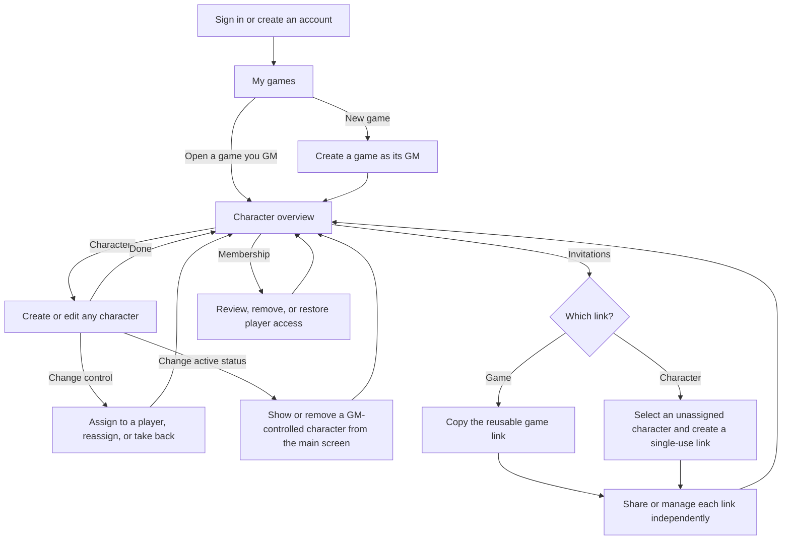
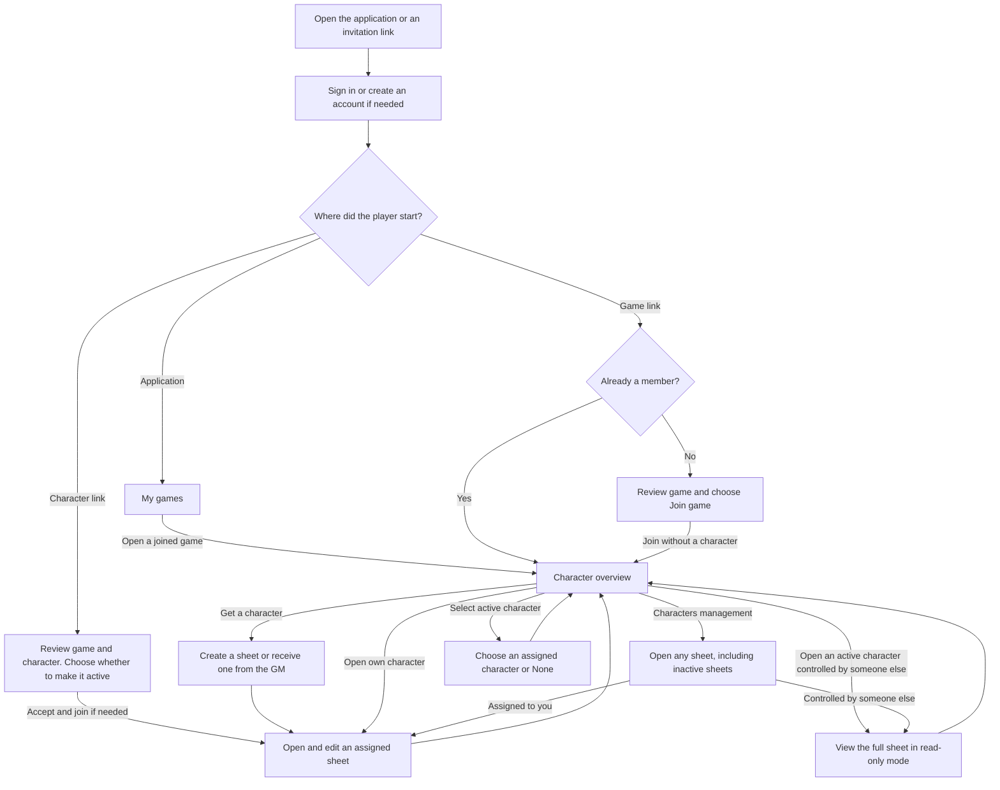

# GM and player separation — UX journey

**Created:** 2026-11-06

## Context

The game owns every character sheet created in it. The GM can manage all sheets. Players can edit sheets assigned to them and read the rest of the cast. The game overview centers on characters, with membership and invitations available as separate management actions for the GM. See the [user stories](story.md).

The current application lets a single GM create games and manage characters through game-specific player records. This journey introduces accounts and game membership, and lets the GM create characters directly in a game before any players join. Existing games, player records, and character sheets do not require migration for this release. See the [UX guidelines](../../../spec/ux.md) and [character setup journey](../character-setup/ux.md) for the earlier flow.

The GM persona and interview are simulated. Their suggestions about finding characters quickly and making visibility clear are hypotheses. The flow has yet to be tested with GMs or players. See the [GM persona](../../../research/personas/game-master.md) and [simulated interview](../../../research/interviews/game-master.md).

## Accounts and game overview

Users create an account and sign in with a username and password. A signed-in user sees the games they can access and their role in each. The same account can be a GM in one game and a player in another. The creator is the game's sole GM. A GM who plays a character uses a GM-controlled character in the same game.

The game opens to a character overview with tabs for active characters. Show the game name, the user's role, and whether the sheet is editable. The GM can assign or reassign characters to a player, and take one back under GM control. A GM can run the whole game this way with no player accounts.

Every member can read all full sheets from **Characters management**, including inactive sheets and their notes. Players can edit only the sheets assigned to them. The main game screen shows active characters in tabs. Each player or the GM can choose one of that player's assigned characters or **None**. The GM can make each GM-controlled character active or inactive independently. Opening a sheet in **Characters management** leaves its active status unchanged.

The roster and active tabs update automatically while the game is open, including when another member changes their active character. An open sheet also shows changes saved by someone else. If you are editing the same sheet, keep your local input and let you review the latest saved version if the edits conflict.

## GM journey

## Player journey

## Joining by invitation

**Regular game link.** The GM can copy and share one persistent, reusable link. After signing in, the user returns to the invitation, sees the game name, and chooses **Join game**. A new member joins as a player without a character. An existing member opens the character overview directly.

**Character link.** The GM can create multiple single-use links for a character that has no player assigned. After signing in, a user sees the game and character and explicitly accepts. A new player joins the game and receives the character in the same step. An existing player receives it under their current membership. **Make this character active** is selected by default, and the active sheet opens after acceptance. Clearing it keeps the player's previous active selection and opens the claimed sheet in **Characters management**.

**Link controls.** The GM manages each link independently. Disabling or rotating one link affects only that link. A disabled link can be re-enabled, and rotation replaces the previous URL for that link. Existing memberships and character assignments continue. Whenever a character changes controller, all its invitation links are removed, including a link just used to claim it. If the sheet later returns to GM control, the GM creates a fresh link to invite another player. If two people try to claim the same character, only the first successful acceptance grants control.

## Creating and assigning characters

| Action                          | Experience                                                                                                                                                                                                                                                                                                                                                                      |
| ------------------------------- | ------------------------------------------------------------------------------------------------------------------------------------------------------------------------------------------------------------------------------------------------------------------------------------------------------------------------------------------------------------------------------- |
| Create a character              | From the overview, a player creates a sheet assigned to them. It becomes active if their slot is empty. A new GM-controlled sheet starts inactive. Open newly created inactive sheets in **Characters management**.                                                                                                                                                             |
| Assign or take back a character | From **Characters management**, the GM can assign a character to a current player, reassign it, or return it to GM control. The same sheet stays in the game and becomes inactive. A character invitation can activate it as part of acceptance when the player selects that option.                                                                                            |
| Select an active character      | The player or the GM chooses which of the player's assigned characters is active. Choosing **None** removes their tab from the main screen. The GM can make GM-controlled sheets active or inactive individually.                                                                                                                                                               |
| Permanently remove a character  | In **Characters management**, the GM can remove any sheet and a player can remove a sheet assigned to them. The confirmation names the character and states that removal is permanent. An active sheet can be removed directly. After confirmation succeeds, the sheet disappears from the roster and its tab disappears for everyone. Its invitation links become unavailable. |
| Remove a player                 | The GM removes the player's game access. Their sheets stay in the game under GM control and become inactive. Invitations cannot bypass removal. The GM can restore the account's access, and character assignment remains a separate action.                                                                                                                                    |

The existing manual character sheet is the starting point. Rules-validated character creation remains separate work. See the [character setup task](../character-setup/summary.md).

## Recovery

| Situation                                        | Expected experience                                                                                                                                                 |
| ------------------------------------------------ | ------------------------------------------------------------------------------------------------------------------------------------------------------------------- |
| Regular link is disabled, replaced, or invalid   | Explain that the invitation is unavailable and suggest asking the GM for an active link.                                                                            |
| Character link is disabled, replaced, or removed | Explain that the character invitation cannot be accepted. Offer a return to the game for current members. An unsuccessful claim does not join the user to the game. |
| Player has no assigned characters                | Show the full character overview and offer **Create character**. The GM can also assign an existing character.                                                      |
| Game or sheet access is lost                     | Explain that the page cannot be opened and offer a return to available games or the game overview as appropriate.                                                   |
| Edit access changes while the sheet is open      | Explain that the edit could not be saved. Keep local input where possible and reopen the sheet in read-only mode if game access remains.                            |
| Save fails, conflicts, or has an unknown outcome | Keep the local edit where possible. Show the current saved state when available so the user can review it before retrying.                                          |

Apply the same role and visibility rules to direct links, data requests, and any future AI-assisted actions.
