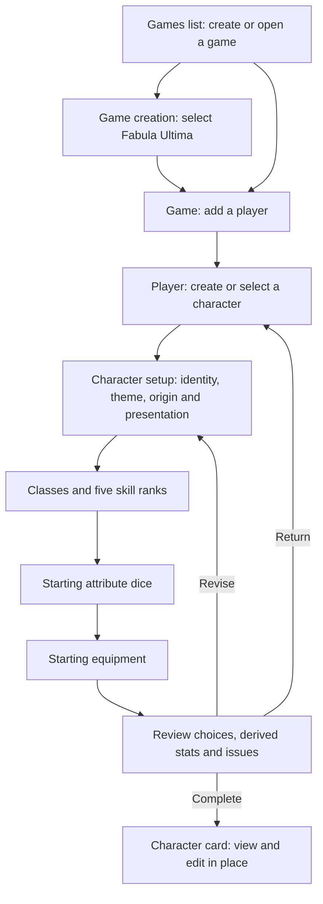

# Character setup — UX journey

**Created:** 2026-11-04

This journey describes the future rules-validated flow. The first release uses a named manual sheet with in-place editing. [UI prototype](ui.md) · [Technical design](tech.md) · [Implementation plan](plan.md)

## Evidence and current flow

The [story](story.md) establishes the GM's goal. The supplied Fabula Ultima PC specification describes the creation procedure and permits revisiting choices; the remaining rule data will be supplied in a later task. The [UX guidance](../../spec/ux.md) assumes a single GM and a multi-system product.

The current [games view](../../../packages/frontend/src/modules/games/GamesView.vue) lists games and creates one with a permanent system choice. It does not open a game; the [system catalog](../../../packages/backend/src/modules/rpg-systems/catalog.ts) currently contains Dungeons & Dragons 5e only. There is no player or character flow in the inspected frontend. The saved-game foundation is described in the [game creation task](../game-creation/summary.md). This journey proposes additions; it does not claim they exist.

## Journey and screens

Setup can be revisited in any order. Show the game, player, update status, remaining choices, and available calculations during setup. The system is fixed when the game is created. World and party references may be supplied when available but are not required.

## Recovery and boundaries

| Situation | Expected behavior |
| --- | --- |
| Character is incomplete | Keep the character and show outstanding choices. |
| Update fails | Keep the local edit and offer retry. |
| Update outcome is unknown | Let the GM check saved state before retrying. |
| A changed choice affects another | Show affected choices and preserve input while the GM resolves them. |
| A choice is missing or invalid | Show the issue at the relevant step and in review. |
| Character is completed | The GM can edit it later. |
| GM leaves while an update is unresolved | Preserve the local edit and explain its status. |
| Game uses another system | Do not start Fabula character setup. |

## Player and character rules

- A player has a name and belongs to one game; players are not reused across games.
- A player can own multiple characters, with at most one active at a time. A character belongs to one player.
- The character card is the same screen for players and the GM; editing happens in place. The GM can edit any character after creation, including inactive characters. Access and permissions remain to be designed.
- Starting cash handling is deferred. Rule data will be supplied in a later task.
