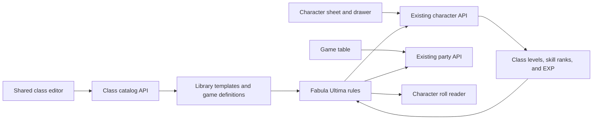
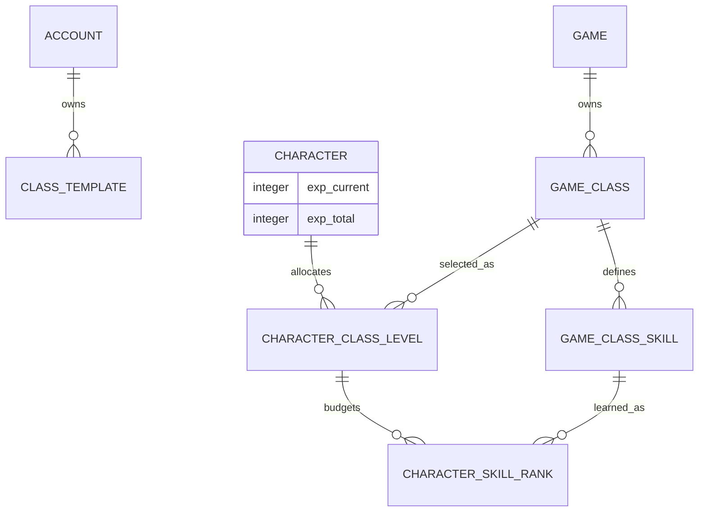
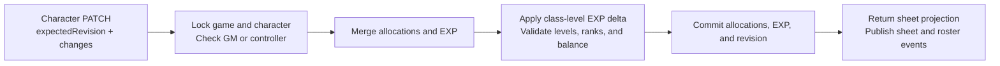

# Class management — technical design

**Draft for review** · [UX and prototype](ux.md) · [OpenAPI 3.1](openapi.yaml)

## Production boundary

The Histoire stories exercise the proposed catalog and character routes through MSW. Production already has a revisioned [character sheet](../../../packages/backend/src/modules/characters/workspace-service.ts), a batched [party view](../../../packages/backend/src/modules/characters/party-service.ts), and a [roll reader](../../../packages/backend/src/modules/characters/roll-reader.ts). The current `classes` and `skills` on a sheet are manual entries.

| Entry point | Production connection |
| --- | --- |
| Library and game classes | Reuse the class editor and pickers. Provide a catalog client through [API services](../../../packages/frontend/src/shared/api-services.ts). Scope library requests to the signed-in account and game requests to the active game. |
| Character sheet and game-table drawer | Mount the prototype's class and EXP controls in [CharacterView](../../../packages/frontend/src/modules/characters/CharacterView.vue). Use the existing revisioned save queue and `canEdit`. Load game definitions for selection and display. |
| Game table | Reuse the compact class summary with the [party query and sheet drawer](../../../packages/frontend/src/modules/game-table/GameTable.vue). Show public class names and current dice from the party response. Open full class details through the authorized character read. |

## Data model

- **Class catalog owns definitions.** `class_templates` stores an account-scoped revisioned definition. `game_classes` stores the same class metadata and free benefits. `game_class_skills` stores ordered skills with stable IDs, rank caps, and effects. Store benefit lists as validated JSONB. Copying a definition assigns new skill and benefit IDs. Editing a game class preserves IDs of surviving skills.
- **Characters owns progression.** `character_class_levels` keys by character and game class. `character_skill_ranks` references the selected class and a skill from it. Scope foreign keys to the same game. Store Current and Total EXP as integer columns on `characters`. Use positive stored allocations, with absence representing zero.
- **Compatibility.** New and existing sheets start managed progression at **50 / 50 EXP** with no allocations. Preserve existing character level and manual class and skill rows. Manual entries remain editable through the existing sheet fields and have no automatic effects. Keep the current character GET readable for game members. Attach managed progression only when `canEdit` is true.
- **Ownership.** Implement catalog writes in a class catalog module. The characters module owns its tables and exports transaction-bound progression operations for catalog changes. Compose both in the application layer and use domain ports for cross-module writes. Follow [code conventions](../../spec/code-conventions.md).

## Write rules

### Catalog

- The library is private to the authenticated account. The GM of the target game can copy a Fabula Ultima template into it. Active game members can read its catalog for class selection. Only the game's GM can change game definitions or save one to their library.
- Copy into the game with a new identity. **Save to library** snapshots the game definition into a new template or replaces the selected template at its existing identity. Game assignments and source definitions stay intact. Check expected source and destination revisions. Use client-generated IDs and create receipts for retryable creates, following character creation. After authorization, a matching receipt returns the created record while it exists, even if the source revision has advanced. A reused ID with different intent or a removed result returns `409 id_conflict`.
- When an edit removes learned skills, return `409 skill_removal_confirmation_required` with the affected characters and ranks. Require the GM to echo the confirmed impact. Recheck affected skill IDs, character IDs, and ranks under the game lock. If they differ, return the refreshed impact. Delete confirmed ranks with the definition change, keeping class levels and EXP. Reject a lower skill cap while a character has a rank above it.
- Refuse game-class deletion while any character has levels in it. Game definition edits take the game lock before affected character rows, bump the class revision and affected character revisions, and publish after commit. Reuse the game `roster` event to invalidate the game catalog and party caches and `sheet` to invalidate affected open sheets. Library writes stay local to library cache invalidation.

### Character progression

Extend `changes.progression` on the existing character PATCH. Provided class-level or skill-rank arrays replace their respective allocations. The server merges omitted fields, validates the final allocation, and uses `10 × (new assigned levels − saved assigned levels)` to debit or refund Current EXP. If EXP is edited in the same patch, its supplied balances are the values before this allocation delta. Total EXP changes only by explicit editing. Character level remains a separate field.

Every assigned class level costs 10 EXP, including starting allocations. Skill edits and character-level edits leave EXP alone. Reject insufficient EXP, cross-game IDs, duplicate IDs, and ranks above their skill cap or class budget. After any edit, Current is between zero and Total, and Total minus Current covers all assigned class levels. Keep the prototype limits of five selected classes and ten levels per class. Character level and assigned class levels can differ.

Keep manual EXP edits ordered relative to class allocations in the optimistic queue. Send them as separate saves against the last acknowledged revision. Reuse the existing rejection and uncertain-save recovery.

## Shared projection

Calculate effects from saved game definitions and character allocations. Apply class free benefits at the first level and configured skill effects per rank. Add signed modifiers and clamp dice to d6–d12. Feed adjusted DEX and INS into attribute-based defenses. Fixed armor supplies the fixed base and explicit defense overrides take precedence over calculated defense. Base MIG and WLP feed resource maxima. Add modifiers after any maximum override, clamp to the API's numeric bounds, and preserve current HP, MP, and IP. Text effects remain available for inspection.

Use the same calculation for character reads, batched party reads, and default roll dice. Keep existing explicit roll-die selection. On the client, reuse the projection math for optimistic previews with parity coverage against the server. The server's saved result is authoritative.

## API review

The [task OpenAPI contract](openapi.yaml) covers catalog routes and the affected character and party contracts. Reuse the session cookie, write Origin and CSRF checks, and existing error envelopes. Add the approved contract to the [canonical API](../../../packages/backend/openapi/openapi.yaml) at implementation, along with Ajv request schemas and parity coverage.
