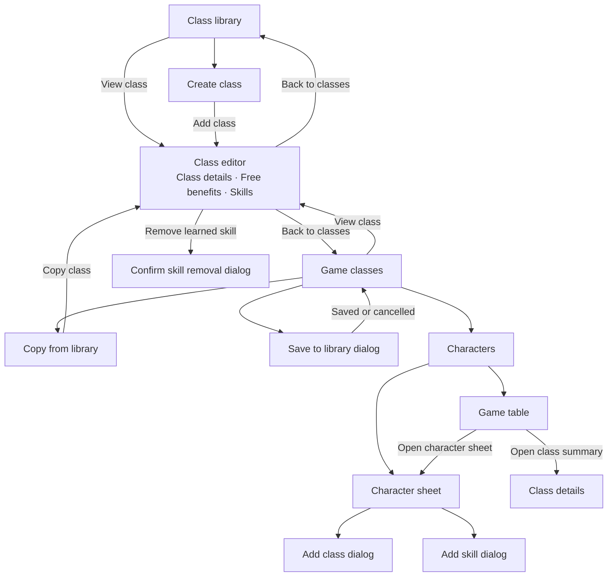
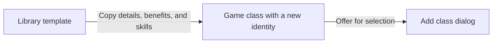
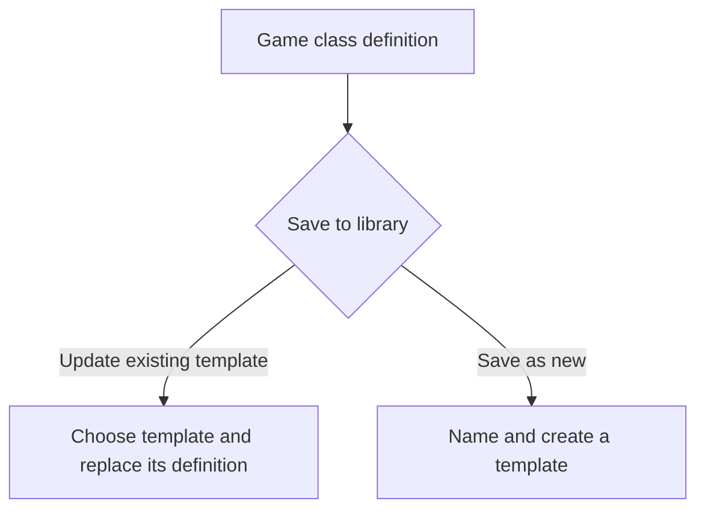
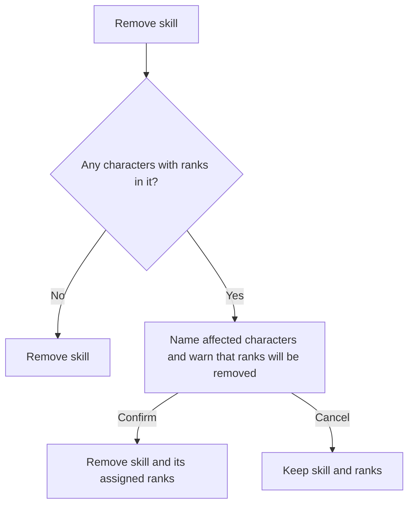

# Class management — UX

See the [user story](story.md), [UX guidelines](../../spec/ux.md), and [UI conventions](../../spec/ui.md).

## Domain language

| Term | Meaning |
| --- | --- |
| Library class (template) | A reusable Fabula Ultima class definition. The library starts empty. |
| Game class | An independent copy in a game. Characters select game classes. |
| Free benefit | A stat modifier or descriptive effect granted by selecting a class. |
| Class level | A character's level in a class. It sets that character's skill-rank budget for the class. |
| Skill rank | A character's investment in a skill. The skill defines its rank cap and any scaling. |

## Actions by role

The GM can edit every character and handles all edits when running the app alone. Players can edit their own character.

| Role | Action | Screen or control | Scope |
| --- | --- | --- | --- |
| GM | Browse and create templates | Class library → **Create class** | Library |
| GM | View or edit class details, free benefits, and skills | Class editor tabs | Library or game class |
| GM | Copy a template into the game | Game classes → **Copy from library** | Current game |
| GM | Update a template or save a new one from a game class | Game classes → **Save to library** | Library |
| GM | Remove a game class | Game classes → **Remove class** | Current game |
| GM | Confirm removal of a skill characters have learned | Skills tab → removal dialog | Affected characters |
| GM, Player | Edit current and total EXP | Character sheet → **EXP** | Any character for GM, own character for player |
| GM, Player | Edit character level | Character sheet → **Level** | Any character for GM, own character for player |
| GM, Player | Add a class, change class levels, learn skills, and adjust ranks | Character sheet → **Classes & skills** | Any character for GM, own character for player |
| GM, Player | Inspect class benefits and skill effects | Character sheet or game table → class details | Any character for GM, own character for player |

## Screen map

Use the same editor in both contexts. Show whether the GM is editing the library template or the game class.

## Data flows

### Copy a library class into a game

Show the destination game before copying. Copies stay independent, including repeated copies of the same template. Edits to a game class affect the characters using it.

### Save a game class to the library

Updating keeps the selected template's identity. Saving is available while characters use the class. The class and its assigned levels and skill ranks stay in the game.

### Remove a skill from a game class

Recalculate affected characters' benefits and keep their class levels. Removing a library skill affects only the template.

## Character progression

- Characters start at level 5 with **50 / 50 EXP**. Every class level costs 10 Current EXP, including the five starting allocations. Removing a class level refunds 10. Save the class level and EXP change together. Character level is edited independently of EXP and class levels.
- Adding a class saves level 1 and applies its free benefits immediately. Learn skills separately.
- **Support house rules.** GMs define classes, skill rank limits, and effects. Use the [Fabula Ultima rules](../../spec/fabula-ultima/character-spec.md) for built-in calculations. Groups adjudicate text effects and decide which tabletop progression restrictions to follow.
- The prototype supports five classes per character, ten levels per class, and unspent starting points. Reduce assigned skill ranks before lowering a class below their total. Add weapons or spells granted by skills manually.
- Calculate modifiers from selected classes and learned skills. Scale effects by rank where configured. Support signed modifiers to maximum HP, MP, and IP, Defense, Magic Defense, and attribute die steps (d6–d12). Defense formulas use adjusted DEX and INS where applicable. Maximum HP and MP use base MIG and WLP. Current HP, MP, and IP stay as entered.

## Screens

- **EXP** — Show two editable inputs next to character level, **Current / Total**. Add earned EXP to both. Spending and refunds change only Current. Total minus Current is EXP spent.
- **Sheet** — Use a **Classes & skills** section with initially collapsed class cards and segmented −/+ bars. Open **Add class** from the section and **Add skill** from the class. Hide edit controls in read-only views.
- **Class cards** — Show free benefits as compact pills above the skill cards. Put ranks and effects on the skill cards once. Open full text effects on demand.
- **Game table** — Place one class summary below stats and above weapons. Show skill previews on hover or focus and open the shared class cards for details. Edit in the existing sheet drawer.
- **Sheet and table** — Show current attribute dice. On the sheet, show the base die where it differs.

## Other states

- Offer class creation for an empty library and retry if loading fails. If there are no templates to copy, link to the library and keep the return path to the game.
- Keep the selection if a copy or library save fails. If the outcome is uncertain, check the destination before retrying.
- In the prototype, remove a class from character sheets before removing it from the game. Keep existing manual entries until a migration is available.

Prototype links · [Class management](../../../packages/frontend/prototypes/class-management/ClassManagement.story.vue) · [Class progression](../../../packages/frontend/prototypes/class-progression/ClassProgression.story.vue) · [Player views](../../../packages/frontend/prototypes/class-progression/PlayerProgression.story.vue)
