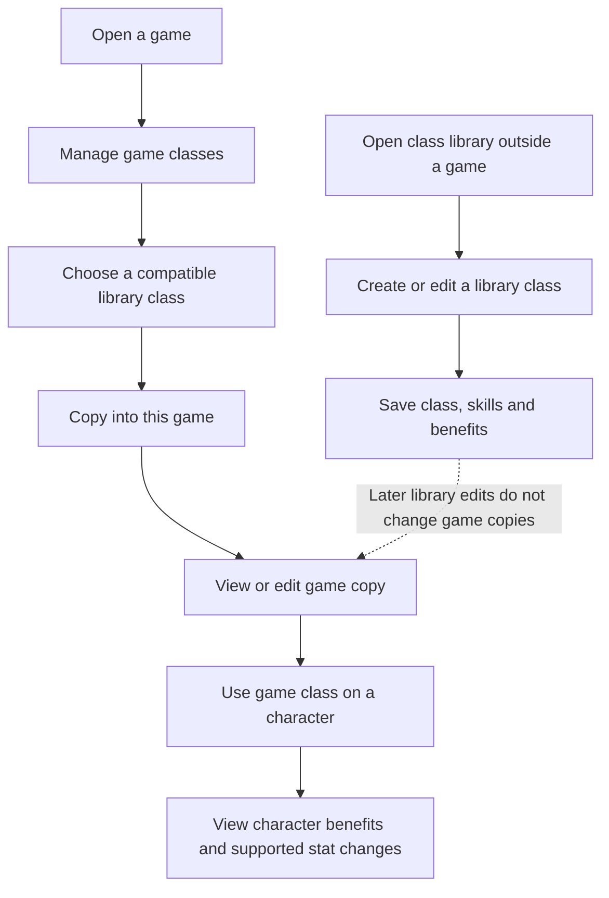

# Class management — UX journey

**Created:** 2026-11-12

## Context

The [story](story.md) and the GM's direction establish a reusable library outside games. A class copied into a game is independent: edits to the library class do not change the game copy, and the GM edits the game copy separately. The library starts empty. This journey is proposed and has not been tested with users.

The [UX guidelines](../../../spec/ux.md) assume one person operating as GM for now and defer player workflows. The product supports multiple RPG systems, so classes and game choices must identify their system. The current [character sheet](../../../../packages/frontend/src/modules/characters/sheet/CharacterSheet.vue) has manual class and skill entries; its [skill section](../../../../packages/frontend/src/modules/characters/sheet/entries/SkillsSection.vue) says ranks and effects are not automated. This journey describes new behavior, not existing functionality.

Class management must look and work the same in the library and game contexts: use the same layout, fields, terminology and editing flow for class details, skills and benefits. Clearly identify whether the GM is editing the library class or a specific game's copy. Context-specific actions, such as copying a library class into a game, may differ without changing the shared management experience.

## Journey

| Stage | GM action and feedback | Outcome |
| --- | --- | --- |
| Library | Open the class library without opening a game. See saved classes and their RPG system. An empty library explains that the GM can create the first class; there are no precreated classes. | The GM can prepare reusable material independently of a game. |
| Create or edit | Select the system and enter a name, class description, free benefits and skills, including each skill's description and rank limit. A benefit can be descriptive text or a modifier to a supported engine stat; show the chosen stat and modifier for the latter. | The GM can review what the class grants and which effects the engine can apply. |
| Save to library | Save and return to or view the library class. Identify this as the library version and explain that later edits do not update game copies. | The saved class is available to copy into compatible games. |
| Add to game | From game class management, browse compatible library classes, review a class and copy it into the current game. Identify the destination game and explain that the copy is independent before saving. | The game has its own class definition, including the copied skills and benefits. Other games and the library remain unchanged. |
| Manage game copy | See the game's classes and open a copy for editing. Clearly label the game context; save changes to that game only. The GM makes any desired library changes separately. | The GM can tailor the class for that game without changing its library source or other games. |
| Remove a used skill | When removing a game class skill used by characters, show a warning naming each affected character and explaining that the skill will also be removed from them. Let the GM cancel or confirm removal. | On confirmation, the skill is removed from the game class and every character using it. Cancelling keeps the skill and character entries. |
| Character | Select a class available in the game for a character. Show the character's benefits with their source, distinguishing text effects from supported stat modifiers. Show the affected stat and resulting value when the modifier applies. | The GM can understand what is applied automatically and what must be interpreted during play. |

The exact class selection and skill-rank progression flow requires further design against the [Fabula Ultima character rules](../../../spec/fabula-ultima/character-spec.md). Free class benefits apply once on acquiring a class; skill benefits depend on acquired skills and ranks. Do not present a text benefit as an automatically applied effect.

## Recovery and boundaries

- **Empty or unavailable library:** Offer creation when empty. If loading fails, report the error and offer retry; do not claim the library is empty.
- **No compatible classes:** Explain that the game has no compatible library classes to copy and offer a route to the library. Preserve game context when returning.
- **Incomplete or invalid entry:** Identify what needs correction while retaining the rest of the form. Only supported stats can be selected for automatic modifiers; descriptive effects remain available as text.
- **Save or copy failure:** Preserve the entered data or selection, report API errors through a toast with a next action, and allow retry. If the outcome is unknown, let the GM check the destination before retrying rather than claiming success.
- **Leaving with unsaved changes:** Warn that changes would be lost and allow the GM to continue editing or discard them.
- **Library and game copies:** Always make the edited context clear. A library edit never silently changes a game copy, and an edit to a game copy never changes the library or another game.
- **Skill removal:** An in-use skill is removed from affected characters only after the GM confirms the warning. Show the affected character names and the consequence before confirmation. Removing a library skill does not remove it from game copies or characters.
- **Existing character entries:** Preserve existing manual class and skill information until a migration or conversion flow is designed; do not imply it is already linked to catalog classes.

## Questions for the next phase

- When a game class or one of its skills is edited, or an entire class is removed, how should existing character choices, benefits and stats be handled? The skill-removal behavior is specified above; other disruptive changes still need a decision.
- Can the same library class be copied into a game more than once, and how should similar names be distinguished?
- Should the GM be able to compare a game copy with its library source or explicitly copy updates later? Independence is required; a synchronization workflow has not been requested.
- Which game-engine stats and modifier operations are initially supported, and how are benefits from skills with choices or ranks represented?

These flows are design assumptions, not validated research. Test them with GMs, especially the distinction between editing a library class and editing a game copy.
