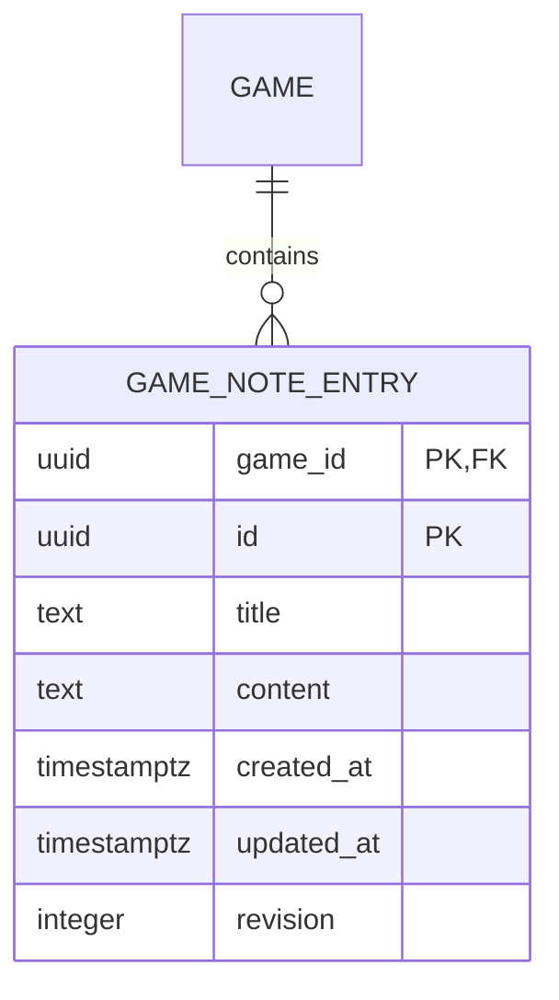
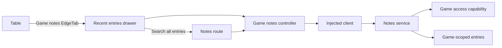

# Game notes — technical design

## Production boundary

Supply a GM-only Game notes action tab to the GameTable EdgeTabs rail from the table branch of `packages/frontend/src/modules/games/GameView.vue`. Register `/games/:gameId/notes` in `src/main.ts` under the existing Games navigation and signed-in shell. Handle tab activation by opening the same right-side USlideover as Throw history over the mounted GameTable. Dismissing it preserves the table URL and state. The drawer reads the three latest entries from the same game-scoped collection. Its Search all entries action opens the notes route, whose page header owns New entry. Direct navigation loads the game and verifies the role before requesting entries. A player gets an unavailable screen and a return link. Reset game-scoped state on sign-out, access loss or game switch.

Create frontend `modules/game-notes` with types, HTTP adapter, controller and views. Promote EntryFields and the reviewed dialog/results layouts into production; update the gallery to consume them. Production imports only production modules. Inject the client via the shared ApiServices registry and assemble it in main.ts. Use the shared request/secureFetch path. Keep a game-keyed collection, derive results locally and isolate draft/edit queues by game and entry ID. Reuse useOptimisticSave. Keep queues alive across in-game navigation until settled. On reopen refetch authorized entries; guard late responses after switching games. The complete authorized collection supports literal case-insensitive title/content search locally. This assumes campaign-sized notebooks; a paged server search would require a contract change.

Add backend `modules/game-notes` with public interfaces in types.ts, Ajv request schemas, service/factory and controller. Wire in app.ts with the existing session, origin/CSRF, mutation limiter and Games access capability. The module writes only its own table. Keep all note data out of player projections, game event streams and logs.

## Data and flows





```mermaid
sequenceDiagram
  participant C as Client queue
  participant S as Notes service
  participant DB as PostgreSQL
  C->>S: PATCH game, entry, changes, expectedRevision
  S->>DB: Begin and lock game; require current GM
  S->>DB: Resolve composite key and verify revision
  alt Revision differs
    S-->>C: 409; refresh and preserve local draft
  else Accepted
    S->>DB: Apply changed fields and commit
    S-->>C: Current entry with server dates and revision
  end
```

List reads must enforce ownership at read time (owner-qualified projection or the same transaction/lock). Lock the game for writes with the injected transaction-bound GameAccessService. Players receive 403, unknown/inaccessible games and foreign entry IDs receive 404. Check game access before entry existence. Read and write using bound parameters. Sort by updated_at DESC, id ASC. Render user text through Vue text bindings.

Client-generated UUIDs identify create attempts. Inserting an existing composite key returns 409 and leaves the existing entry intact. If a create acknowledgement is lost, refetch by game and reconcile the same ID and submitted text before allowing another attempt. Different text must surface a conflict. A PATCH includes at least one of title/content. Validate normalized fields, reject server-owned properties, and use the existing JSON body limit. Only a real text change advances revision and updated_at. Keep created_at immutable. For uncertain PATCH results compare fresh text and expected changes before offering a retry. A stale tab must never silently overwrite a later revision.

## Database changes

Add the next versioned SQL migration in packages/backend/drizzle and its journal entry, and declare the table in the Drizzle schema. Composite primary key (game_id, id); game_id references games.id ON DELETE CASCADE. All columns non-null. Require trimmed nonblank title of 1–160 characters, content length ≤16,000, revision ≥1, updated_at ≥created_at. Default revision to 1 and both dates to the transaction timestamp. Index (game_id, updated_at DESC, id ASC). Existing games start with zero entries; existing tables and seed data require no backfill. Empty notes are a valid demo state.

From repository root with a local migrated game database, set MIGRATION_DATABASE_URL to the schema owner and DATABASE_URL to the restricted application login. Run:

```sh
pnpm --filter @rpg-engine/backend migrate
psql "$MIGRATION_DATABASE_URL" -v app_schema=public -v app_role=rpg_runtime -f packages/backend/scripts/runtime-grants.sql
DATABASE_URL="$MIGRATION_DATABASE_URL" pnpm seed:demo
```

Extend the grants script with SELECT, INSERT, UPDATE on game_note_entries. Use the existing game-lock privileges. Seed with a local account that has the seed script's required privileges. The optional `seed:demo --reset` destroys the local schema and its data; preservation checks use the ordinary migration against populated data.

## API contract

[OpenAPI 3.1 task contract](openapi.yaml). Merge the operations and note schemas into the canonical backend contract during implementation. Extend schema-contract.test.ts to compare the Ajv write envelopes. Writes require the session cookie, valid origin and CSRF token. Structured validation errors use 422. Transport and domain errors retain the standard application envelope.
