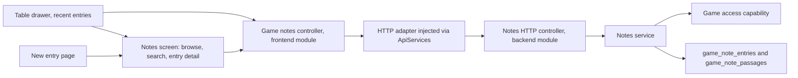
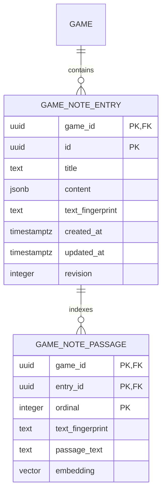
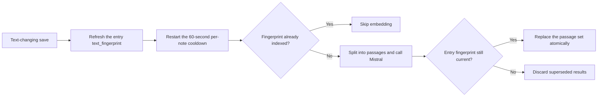
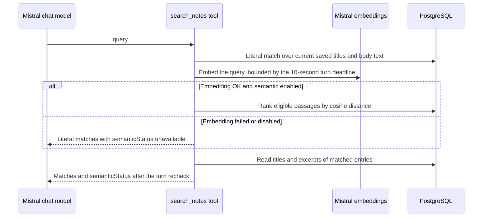

# Game notes — technical design

**Draft for review** · [UX spec](ux.md) · [Proposed OpenAPI 3.1 contract](openapi.yaml)

## Production boundary

The [prototype](../../../packages/frontend/prototypes/game-notes/GameNotes.story.vue) drives the notes screens through the shared MSW worker and the production HTTP transport helper. Production keeps that interface and connects it to game-scoped authenticated routes, Postgres persistence and read-only Agent retrieval. No existing HTTP operation changes; this task only adds paths, module internals and tables.



| Entry point | Production connection |
| --- | --- |
| Table drawer (GM only) | The edge rail belongs to [GameTable](../../../packages/frontend/src/modules/game-table/GameTable.vue), which already supports an extra `panelTab` prop with an `edge-panel` slot — an unclaimed right-side panel extension. The GM's table is mounted through [AgentTable](../../../packages/frontend/src/modules/agent/AgentTable.vue), so AgentTable composes the Game notes panel tab; the player table gets no notes tab. The panel opens over the mounted table without changing its URL or state. The role comes from the existing game query (`role === "GM"`), and drawer cards use the paginated notes list. |
| Notes screen and new entry | Register `/games/:gameId/notes` and `/games/:gameId/notes/new` in the router in [main.ts](../../../packages/frontend/src/main.ts) and provide the notes client through the [ApiServices](../../../packages/frontend/src/shared/api-services.ts) composition root. On a direct visit, wait for the game query and show players an unavailable screen with a route back instead of requesting notes. Entry detail is a state of the notes screen, not its own route. |
| Agent chat | Two read-only tools in the scoped read registry; see [Agent note tools](#agent-note-tools). |

- Create a frontend `modules/game-notes` module with views, a controller and an HTTP adapter, with a `types.ts` owning the entry and document shapes. Inject the game-scoped client through `ApiServices` and use the shared secure request path. Keep drafts and save queues scoped by game and entry ID. Clear state on sign-out, access loss or game switch, and ignore late responses from the previous scope. Cancelling creation returns to the notes list and keeps the draft for the same game; a successful create replaces the creation route and opens the saved entry.
- Share the Quill editor between creation, detail and the gallery. Quill 2 ships its own TypeScript declarations; `@types/quill` is not needed. Use the toolbar and paste allowlist from the UX spec. Treat the editor and toolbar as one focus boundary for autosave. Render previews from the validated document using fixed Vue elements and text bindings, never stored HTML or `v-html`.
- Adapt the prototype types to the production contract: the prototype `NotesApi` lists without paging or search and cannot read one entry, so the production adapter adds `q`, `cursor` and `nextCursor`, plus a by-ID read for write recovery. The prototype helpers `visibleNoteText`, `sameNoteDocument` and the 5,000 code point limit move from `prototypes/game-notes/note-document.ts` into production code, mirroring the backend's canonical normalization with parity coverage. Reuse `NoteBody`, the fixed-element renderer built from validated ops, and the remaining note components.
- Add a backend `modules/game-notes` module following the module conventions: `schema.ts` for the Drizzle tables, `contract.ts` for Ajv request schemas, `service.ts`, `controller.ts` and `types.ts`. Compose it in `app.ts`. The routes live under `/api/games`, so the existing write-Origin, session and account mutation rate limit middleware already covers them; keep the existing 96 KiB request limit. Use the Games access capability and keep note data out of player projections, event streams and logs.

## Data and flows



- **Access and paging.** Validate access before looking up entries: players get 403, and unknown or inaccessible games and foreign or missing entry IDs get 404, matching the `access.role !== "GM"` forbidden pattern of the sibling services. Enforce ownership at read time and recheck it using the transaction-bound `GameAccessService` on writes. Use cursor pagination ordered by `updated_at DESC, id ASC` for both lists. The server applies case-insensitive literal search across the title and concatenated text inserts (excluding the terminal newline) before paging. Scope each cursor to its game and query. Reset paging when the query changes and ignore results from superseded requests. Deduplicate appended entries by ID.

```mermaid
sequenceDiagram
  participant C as Client save queue
  participant S as Notes service
  participant DB as PostgreSQL
  C->>S: PATCH with changes and expected revision
  S->>DB: Begin, lock game, require current GM
  S->>DB: Read entry by game and entry ID
  alt Stale revision
    S-->>C: 409; refresh and retain draft for explicit retry
  else Current revision
    S->>DB: Apply actual changes and commit
    S-->>C: Current entry with server dates and revision
  end
```

- **Writes.** Reuse `useOptimisticSave` for edits. Keep `created_at` immutable; advance `updated_at` and the revision only when the normalized title, text or formatting changes. On an uncertain write, refetch the entry by ID and reconcile against the expected title and body before offering a retry. For create, reuse the client-generated entry ID and treat a matching entry as acknowledgement; a conflicting entry must not be overwritten.



- **Indexing.** The `text_fingerprint` on `game_note_entries` is the SHA-256 of the normalized title and visible body serialized as a JSON array, refreshed only by saves that change title or visible body text; formatting-only saves advance the revision without touching it, and a GM who edits and restores text keeps the fingerprint and skips embedding. `game_note_passages.text_fingerprint` records the entry text a passage set was generated from, so a passage is eligible only where it equals the entry's current fingerprint and superseded passages are never returned. Compute `semanticStatus` from this fingerprint join, not from in-memory timer state. One backend process owns the scheduler today, as it owns Agent admission; on process start, sweep games with mismatched fingerprints and schedule indexing immediately — this doubles as the backfill for notes saved before semantic indexing shipped, without changing saved entries.



## Agent note tools

Register `search_notes` and `get_notes` in the existing scoped read registry in [agent-reads.ts](../../../packages/backend/src/application/agent-reads.ts), and add a notes read capability to `AgentDependencies` composed in `app.ts`, following the `deps.npcs` injection pattern. The tools are typed against the tool context that already carries `actor`, `gameId` and `reauthorize`; neither tool accepts an actor or game ID. Recheck current-GM access at execution and use the existing turn reauthorization before passing results to the model or saving the reply. Authorization failure is a tool or turn error, not an empty search. Treat note text as reference data, never as instructions or authorization to run another tool. Tool labels and operational logs must not contain note text or search queries.

### `search_notes`

- **Input:** `{ query: string, limit?: integer }`. Trim the query; require 1–512 characters after trimming. `limit` defaults to 5 and must be 1–10. Reject unknown properties.
- **Output:** `{ matches, semanticStatus }`. Each match is `{ entryId, title, excerpt, source }`, where `excerpt` is up to 600 visible text characters and `source` is `literal` or `semantic`. Return at most one match per entry. A title-only note can return an empty excerpt. Put literal matches first (newest first, then ID ascending), followed by semantic matches ranked by relevance with ID as a tie-breaker.
- **Freshness and relevance:** Literal lookup matches the trimmed query case-insensitively against all current saved titles and visible body text. Semantic lookup uses only passages whose `text_fingerprint` equals the entry's current fingerprint, so formatting-only edits do not invalidate embeddings and no superseded passage is returned. Apply a minimum cosine similarity cutoff before ranking and limiting semantic matches. Do not fill unused slots with below-cutoff results. The cutoff does not apply to literal matches.
- **Status:** `ready` means every saved entry's fingerprint is matched by its passages; `indexing` means at least one saved entry's current fingerprint has no matching passages yet; `unavailable` means semantic lookup failed or is disabled. Return valid literal matches even when semantic lookup is incomplete. Empty matches with `ready` means no relevant notes found; empty matches with `indexing` or `unavailable` must not be presented as proof that no relevant note exists. A failure to read current saved notes is a tool error, not an empty result.

### `get_notes`

- **Input:** `{ entryIds: string[] }`, containing 1–3 unique UUIDs. Reject unknown properties. Use IDs from `search_notes` or IDs already known to the Agent.
- **Output:** `{ entries, missingEntryIds }`. Each entry is `{ entryId, title, text, updatedAt }`. Return the full visible body as plain text, not Quill Delta or HTML. Return both arrays in request order within their respective groups. Missing and foreign-game IDs are indistinguishable and produce no entry data.
- **Freshness:** Read directly from the saved notebook. This tool does not use the index, wait for indexing, or call the embeddings API.

### Embedding provider

Use the [Mistral Embeddings API](https://docs.mistral.ai/inference/embeddings/text_embeddings) with `mistral-embed` (1,024 dimensions) for note passages and search queries. Wrap it in a small corruption-layer client next to the chat provider, configured by an optional `MISTRAL_EMBEDDING_MODEL` setting defaulting to `mistral-embed` — separate from the chat model configured by `MISTRAL_MODEL`, reusing the server-side `MISTRAL_API_KEY`. Send saved titles and visible body passages for background indexing, and the tool's search query for semantic lookup. Do not send Quill formatting, record IDs, or game/account IDs in embedding input.

Start background indexing 60 seconds after the last confirmed save that changed the title or visible body text. Before calling Mistral, skip embedding if the entry fingerprint matches the indexed fingerprint. Recheck the fingerprint before replacing passages to discard results for superseded text. Formatting-only saves do not reset the timer, and the startup sweep re-arms indexing for any mismatch after a restart.

Prefer heading boundaries when splitting notes into passages. Split longer sections into passages of at most 800 visible body code points, with up to 200 code points of overlap between consecutive passages in the same section. Include the note title separately in each embedding input; a title-only note still yields one passage. A heading-only formatting change does not trigger reindexing; use the heading structure at the next text-triggered indexing run.

Respect the Agent turn deadline for query embedding and fall back to literal matching if the provider fails. Before shipping semantic search, calibrate the numerical cutoff using representative GM questions with known answers and questions with no relevant notes. Verify that relevant passages are returned and that unrelated passages are excluded even when they rank first. Durable worker retries and multi-process scheduling still need design.

## Document format

Store a full Quill document Delta, not HTML or an incremental change Delta. Allow nonempty string inserts only, with no embeds or retain/delete operations. Permit `bold`, `italic`, `underline` and `strike` with value `true` on text; permit `header` values 1–3 or `list` values `bullet` and `ordered` on newlines, but never both on the same line. Require a terminal newline. The empty body is `{"ops":[{"insert":"\n"}]}`.

Apply the allowlist server-side independently of client paste filtering. Remove empty attribute objects, merge adjacent inserts with identical attributes, and compare normalized documents structurally. The server normalization is canonical; the client mirrors only the code point counter and the structural equality helper, with parity coverage. Limit body text to 5,000 Unicode code points excluding the terminal newline and compact normalized JSON to 64 KiB. Keep the existing 96 KiB request limit.

## Database

Add two versioned Drizzle migrations and journal entries, split so the HTTP feature does not depend on the extension:

- `014_game_note_entries.sql` — no pgvector dependency; carries `game_note_entries` with `(game_id, id)` as the primary key, a cascading foreign key to `games`, and an index on `(game_id, updated_at DESC, id ASC)`. Require `btrim(title)` of 1–160 characters, a JSON object with a nonempty `ops` array, a revision of at least 1, and `updated_at >= created_at`. Default the revision to 1 and both timestamps to the transaction timestamp. The `text_fingerprint` column is NOT NULL and written by the service on create and on text-changing saves.
- `015_game_note_passages.sql` — requires pgvector; carries `game_note_passages` with `(game_id, entry_id, ordinal)` as its primary key, a cascading foreign key to the entry, the `text_fingerprint` of the entry text the passages were generated from, the `passage_text`, and `embedding vector(1024)` for `mistral-embed`. Replace a note's passage set atomically after verifying the fingerprint is still current. Start with exact cosine-distance ranking over eligible passages; add an approximate vector index only if measurements justify it.

Provision pgvector (extension name `vector`) on the PostgreSQL host and enable it with `CREATE EXTENSION IF NOT EXISTS vector;` in the target database using a deployment role with extension privileges before applying the passage migration. The application runtime role does not install extensions. Grant the runtime role SELECT, INSERT and UPDATE on `game_note_entries`, and SELECT, INSERT and DELETE on `game_note_passages` for reads and transactional replacement; there is deliberately no DELETE on entries — sharing and deletion remain outside this task. Record both grants in `packages/backend/scripts/runtime-grants.sql`.

Existing games start with empty notebooks; no backfill or seed changes are required. `pnpm seed:demo --reset` is the only destructive command: it drops the public schema on a loopback host, which also drops the pgvector extension, so extend the reset to run `CREATE EXTENSION IF NOT EXISTS vector` after recreating the schema and the passage migration stays applicable.

Verify on a populated disposable database as the schema owner for migrations and the restricted login for the application:

```sh
# once per database, as a deployment role with extension privileges
psql "$MIGRATION_DATABASE_URL" -c 'CREATE EXTENSION IF NOT EXISTS vector;'
# apply migrations as the schema owner
pnpm --filter @rpg-engine/backend migrate
# grant the restricted runtime login
psql "$MIGRATION_DATABASE_URL" -v app_schema=public -v app_role=rpg_runtime -f packages/backend/scripts/runtime-grants.sql
# seed and verify with the restricted runtime login
DATABASE_URL="$MIGRATION_DATABASE_URL" pnpm seed:demo
```

## API shape

[Proposed OpenAPI 3.1 contract](openapi.yaml), which passes the repository's redocly minimal lint (the same ruleset as `pnpm --filter @rpg-engine/backend openapi:lint`) and reuses the canonical components, error envelopes and security schemes. Agent tools are internal and are not part of this HTTP contract.

| Operation | Request | Success |
| --- | --- | --- |
| `GET /api/games/{gameId}/notes` | Optional `q` (blank for all entries) and `cursor` (omitted for the first page) | `200` with up to 20 entries and `nextCursor`; `nextCursor` is `null` at the end |
| `POST /api/games/{gameId}/notes` | `{ id, title, content }` | `201` with `{ entry }` |
| `GET /api/games/{gameId}/notes/{entryId}` | — | `200` with `{ entry }`, independent of the active search or page; also used for write recovery |
| `PATCH /api/games/{gameId}/notes/{entryId}` | `{ expectedRevision, changes }` with at least one of `title` or `content` | `200` with `{ entry }` |

An entry contains `id`, `title`, `content`, `createdAt`, `updatedAt` and `revision`; a supplied `content` replaces the full document. Reject unknown fields, unsupported operations and unsupported formats with 400; reject invalid attribute placement, missing terminal newline or exceeded document limits with 422. Return 409 for duplicate IDs or stale revisions. During implementation, fold these operations and schemas into the canonical OpenAPI contract and extend the Ajv-to-OpenAPI parity test (`schema-contract.test.ts`) to cover the notes request schemas.

## Choices needing review

- **Similarity cutoff.** The numerical semantic cutoff must be calibrated on representative GM questions before semantic matches ship; literal retrieval is not blocked.
- **pgvector provisioning.** Every environment that applies `015_game_note_passages.sql` needs the extension available and a deployment role with privileges. Consider holding that migration back in environments that cannot provision it, keeping the notes HTTP feature usable there with semantic search disabled.
- **Indexer durability.** The in-process scheduler is single-process and lost on restart, recovered by the startup sweep. Durable retries, a real queue, and multi-process scheduling are deferred designs.
- **Product assumptions.** GM-only visibility and sending saved note text and search queries to Mistral are product assumptions carried from the UX spec.
- **Approximate index.** Exact cosine ranking is the starting point; an ANN index only if measurements justify it.
