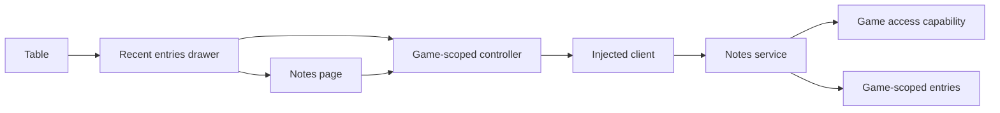

# Game notes — technical design

[UX spec](ux.md)

## Production boundary

- Add the GM-only Game notes EdgeTab in `packages/frontend/src/modules/games/GameView.vue`. Open a right-side drawer over the mounted table, without changing its URL or state. The drawer shows the three most recently updated entries. Search all entries opens `/games/:gameId/notes`, registered in the signed-in Games shell in `packages/frontend/src/main.ts`. Check the current role before requesting notes on a direct visit; show players an unavailable screen with a route back.
- Create a frontend `modules/game-notes` module with views, a controller and an HTTP adapter. Inject the game-scoped client through `ApiServices` and use the shared secure request path. Keep drafts and save queues scoped by game and entry ID. Clear state on sign-out, access loss or game switch, and ignore late responses from the previous scope.
- Use Quill 2 and its bundled TypeScript declarations; `@types/quill` is not needed. Share the editor between creation, detail and the gallery. Use the toolbar and paste allowlist from the UX spec. Treat the editor and toolbar as one focus boundary for autosave. Render previews from the validated document using fixed Vue elements and text bindings, never stored HTML or `v-html`.
- Add a backend `modules/game-notes` module with Ajv schemas, a service and HTTP handlers. Compose it in `app.ts` behind the existing session, origin/CSRF and mutation rate limits. Use the Games access capability and keep note data out of player projections, event streams and logs.

## Data and flows




```mermaid
sequenceDiagram
  participant C as Client save queue
  participant S as Notes service
  participant DB as PostgreSQL
  C->>S: PATCH with changes and expected revision
  S->>DB: Begin, lock game, require current GM
  S->>DB: Read entry by game and entry ID
  alt Stale revision
    S-->>C: 409; refresh and retain draft for explicit retry
  else Current revision
    S->>DB: Apply actual changes and commit
    S-->>C: Current entry with server dates and revision
  end
```

Validate access before looking up entries. Players get 403; unknown or inaccessible games and foreign entry IDs get 404. Enforce ownership at read time and recheck it using the transaction-bound `GameAccessService` on writes. Return entries by `updated_at DESC, id ASC`. Search locally across the title and concatenated text inserts, excluding the terminal newline, with case-insensitive literal matching.

Reuse `useOptimisticSave` for edits. Keep `created_at` immutable; advance `updated_at` and the revision only when the normalized title, text or formatting changes. On an uncertain write, refetch and reconcile against the expected title and body before offering a retry. For create, reuse the client-generated entry ID and treat a matching entry as acknowledgement; a conflicting entry must not be overwritten.

## Document format

Store a full Quill document Delta, not HTML or an incremental change Delta. Allow nonempty string inserts only, with no embeds or retain/delete operations. Permit `bold`, `italic`, `underline` and `strike` with value `true` on text; permit `header` values 1–3 or `list` values `bullet` and `ordered` on newlines, but never both on the same line. Require a terminal newline. The empty body is `{"ops":[{"insert":"\n"}]}`.

Apply the allowlist server-side independently of client paste filtering. Remove empty attribute objects, merge adjacent inserts with identical attributes, and compare normalized documents structurally. Limit text to 16,000 Unicode code points excluding the terminal newline and compact normalized JSON to 64 KiB. Keep the existing 96 KiB request limit.

## Database

Add a versioned Drizzle migration and journal entry for `game_note_entries`. Use `(game_id, id)` as the primary key, a cascading foreign key to `games`, and an index on `(game_id, updated_at DESC, id ASC)`. Require a trimmed nonblank title of 1–160 characters, a JSON object with a nonempty `ops` array, a revision of at least 1, and `updated_at >= created_at`. Default the revision to 1 and both dates to the transaction timestamp. Existing games start with empty notebooks; no backfill or seed changes are required.

Extend `packages/backend/scripts/runtime-grants.sql` with SELECT, INSERT and UPDATE for the runtime role, not DELETE. Apply migrations as the schema owner and verify on a populated disposable database with the restricted runtime login:

```sh
pnpm --filter @rpg-engine/backend migrate
psql "$MIGRATION_DATABASE_URL" -v app_schema=public -v app_role=rpg_runtime -f packages/backend/scripts/runtime-grants.sql
DATABASE_URL="$MIGRATION_DATABASE_URL" pnpm seed:demo
```

## API shape

| Operation | Request | Success |
| --- | --- | --- |
| `GET /api/games/{gameId}/notes` | — | `200` with `{ entries }` |
| `POST /api/games/{gameId}/notes` | `{ id, title, content }` | `201` with `{ entry }` |
| `PATCH /api/games/{gameId}/notes/{entryId}` | `{ expectedRevision, changes }` with at least one of `title` or `content` | `200` with `{ entry }` |

An entry contains `id`, `title`, `content`, `createdAt`, `updatedAt` and `revision`. A supplied `content` replaces the full document. Reject unknown fields, unsupported operations and unsupported formats with 400; reject invalid attribute placement, missing terminal newline or exceeded document limits with 422. Return 409 for duplicate IDs or stale revisions. Add the operations and schemas to the canonical OpenAPI contract during implementation.
