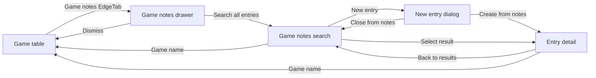
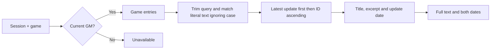

# Game notes — UX and prototype

[Technical design](tech.md)

## Domain language

**Game notes** is one game's private GM notebook. An **entry** has a plain-text title and a rich-text body. Created records when the entry was first saved. Updated records its most recent text or formatting change. The current GM owns access through the game. Game notes are distinct from character sheet notes and throw annotations.

The [provisional GM persona](../../research/personas/game-master.md) describes a GM keeping play moving. A table drawer gives the GM quick access to recent entries during play. This is a design assumption from simulated research. GM-only visibility and per-game search are product assumptions for review.

## Actions by role

| Role | Action | Screen or control | Scope |
| --- | --- | --- | --- |
| GM | Capture an entry | New entry on the notes screen | Current game |
| GM | Read recent entries | Game notes EdgeTab opens a drawer over the table | Three most recently updated entries |
| GM | Search the notebook | Search all entries in the drawer | All titles and content in this game |
| GM | Read or revise an entry | Select a result, edit Title or Content | Selected entry |
| GM | Resume play | Close the table drawer or follow the named game link | Return to the same table |
| Player | Play at the table | Existing table controls | GM notes and their contents are private |
| GM | Share or delete entries | Deferred | Outside this task |

## Screen map



## Data flows



```mermaid
sequenceDiagram
  actor GM
  participant View as Game notes
  participant Store as Game entries
  GM->>View: Enter title and content
  GM->>View: Create entry
  alt Missing title
    View-->>GM: Toast and editable draft
  else Valid
    View->>Store: Create once with stable entry ID
    Store-->>View: Entry and both timestamps
    View-->>GM: Toast and open entry detail
  end
  GM->>View: Edit an existing field and leave the field
    View->>Store: Queue changed title or body at acknowledged revision
  alt Accepted
    Store-->>View: Updated entry and revision
    View-->>GM: Refresh results and metadata
  else Rejected or response uncertain
    View-->>GM: Toast with recovery; retain editable text
  end
```

## Screens and interactions

- **Table.** Keep the party and roll controls in place. The Game notes EdgeTab sits in the same right-edge rail as Character sheets, NPCs and Throw history. Selecting it slides the Game notes drawer in from the right and leaves only its active edge tab visible. Press Escape or use the close button to dismiss it and restore the rail. Render the three latest entries with the shared SurfaceCard used in the class catalog. Each card shows its title, full content and both dates immediately. Dismiss the drawer to resume play at the same position. Search all entries is an underlined ULink to the separate notes screen.
- **New entry.** The notes screen header opens the creation dialog. Creating an entry opens its detail. Closing the dialog preserves the draft for the same game. Title is required after trimming, up to 160 characters. Content may start empty and supports up to 16,000 text characters. Repeated titles are allowed. Reuse CreateFormDialog and LabeledInput for the title, with the Quill editor for the body. A failed request keeps the dialog and draft, including formatting. Disable the form only while submitting. Confirm success with a toast.
- **Formatting.** The toolbar offers Normal text and headings 1–3, bulleted and numbered lists, bold, italic, underline, strikethrough and Clear formatting. No colors, fonts, font sizes, links or media. Pasted content keeps only supported formatting and text. The drawer and results cards display supported formatting without an editor toolbar. Search matches only the title and visible body text, including across inline formatting boundaries.
- **Search.** Keep Games active in the signed-in header. Use the game name as the return link above Game notes. Show the complete list for a blank query. Filter immediately on titles and full content, including text beyond the excerpt. Display newest updates first in the same note cards as the drawer. Search result cards add an Open entry action. Distinguish “No entries yet” from “No matching entries.” Loading and retry use ContentState, with errors in a toast.
- **Entry.** Use the same labeled fields for reading and editing. Leaving a field submits a valid change in the background; moving between the editor and its toolbar does not count as leaving the body field. The list uses the optimistic title and body, and dates use the server acknowledgement. Back to results keeps the search term. Show both timestamps in local time. On a narrow screen wrap header actions and the formatting toolbar, and stack full-width controls. Keep long titles and paragraphs within the viewport.
- **Recovery.** An invalid local title remains editable. A confirmed rejection restores the acknowledged result. An uncertain write retains the draft while the controller refreshes. Retrying reapplies the retained text to the refreshed version only after explicit user action.

## Prototype review

Open **Prototypes / Game notes** in Histoire with `pnpm --filter @rpg-engine/frontend prototypes:dev`. The [story](../../../packages/frontend/prototypes/game-notes/GameNotes.story.vue) mounts the existing GameTable and uses the shared MSW worker. In The Lantern Road, select the Game notes EdgeTab, read a recent entry card, choose Search all entries, capture an entry, search for a phrase inside the content, edit it and return to results. Try “compass” for a seeded match and “observatory” for an empty result.

Review at 390 × 844 and 1280 × 800. The gallery simulates the two screens locally and resets fixtures on reload.

The reviewed gallery uses plain text. Update it to use the same rich-text editor and note renderer as production, then review the toolbar, paste behavior and formatted cards at both sizes.

The Backend scenario control resets the fixtures. Choose Empty for first use, Loading for delayed reads, or Error for failed requests. Return to Default to restore the seeded table.

On 2026-11-17 the prototype type-check and gallery build passed. The [Chromium regression](../../../packages/frontend/prototypes/game-notes/GameNotes.browser.ts) passed at both review sizes. It covers entry creation on the notes screen after opening and dismissing the table drawer, reopening it and choosing Search all entries, case-insensitive content search, a persisted edit through shared MSW, result updates and return to the party. A separate Chromium check opened the built gallery and found the seeded ferryman entry by searching for “compass”.
