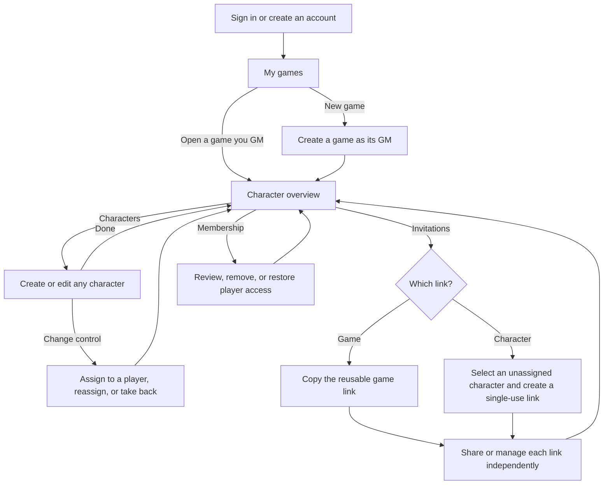
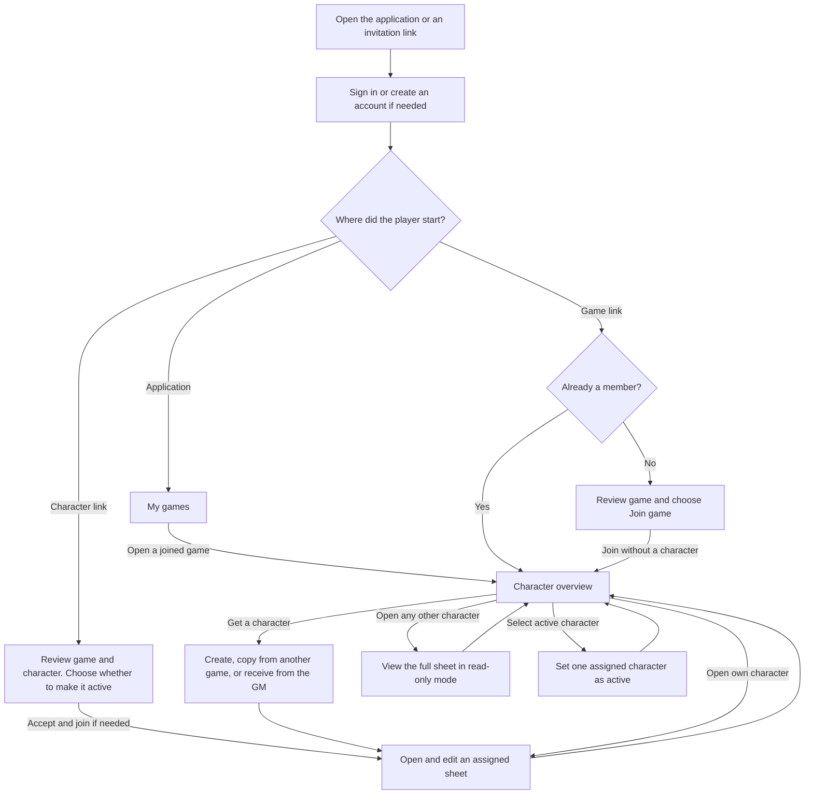

# GM and player separation — UX journey

**Created:** 2026-11-06

## Context

The GM runs the game and can manage all its characters. Players manage their own characters and can see the rest of the cast. The game overview centers on characters, with membership and invitations available as separate management actions for the GM. See the [user stories](story.md).

The current application lets a single GM create games and manage characters through game-specific player records. This journey introduces accounts and game membership, and lets the GM create characters directly in a game before any players join. Existing games, player records, and character sheets do not require migration for this release. See the [UX guidelines](../../spec/ux.md) and [character setup journey](../character-setup/ux.md) for the earlier flow.

The GM persona and interview are simulated. Their suggestions about finding characters quickly and making visibility clear are hypotheses. The flow has yet to be tested with GMs or players. See the [GM persona](../../research/personas/game-master.md) and [simulated interview](../../research/interviews/game-master.md).

## Accounts and game overview

Users create an account and sign in. A signed-in user sees the games they can access and their role in each. The same account can be a GM in one game and a player in another. The creator is the game's sole GM. A GM who plays a character uses a GM-controlled character in the same game.

The game opens to a character overview. Show the game name, the user's role, who controls each character, and whether its sheet is editable. The GM can create and edit every character, assign or reassign one to a player, and take one back under GM control. A GM can run the whole game this way with no player accounts.

Every member can read every full character sheet, including inactive and GM-controlled characters. Players can edit only the characters assigned to them. They can have several characters, with at most one active at a time. Active status does not change who can read or edit a sheet.

## GM journey

## Player journey

## Joining by invitation

**Regular game link.** The GM can copy and share one persistent, reusable link. After signing in, the user returns to the invitation, sees the game name, and chooses **Join game**. A new member joins as a player without a character. An existing member opens the character overview directly.

**Character link.** The GM can create multiple single-use links for a character that has no player assigned. After signing in, a user sees the game and character and explicitly accepts. A new player joins the game and receives the character in the same step. An existing player receives it under their current membership. The sheet opens after acceptance. **Make this character active** is selected by default. Clearing it keeps the player's previous active selection.

**Link controls.** The GM manages each link independently. Disabling or rotating one link affects only that link. A disabled link can be re-enabled, and rotation replaces the previous URL for that link. Existing memberships and character assignments continue. Once redeemed, a character link stays spent. Other unused links for the same character are blocked while it is assigned. If the GM takes the character back, unused links that are still enabled can be accepted again. If two people try to claim the same character, only the first successful acceptance grants control.

## Creating, copying, and assigning characters

| Action | Experience |
| --- | --- |
| Create a character | From the overview, a player creates a sheet assigned to them. A GM can create a sheet under GM control without selecting a player. |
| Copy a character | A player selects one of their own characters from another game they can still access that uses the same RPG system. Copy all data attached to the character, including its current state. Open the independent copy in the destination game. Edits to either sheet affect only that sheet. |
| Assign or take back a character | From the character overview, the GM can assign a character to a current player, reassign it, or return it to GM control. The same sheet stays in the game. If it was the former player's active character, clear that selection. |
| Select an active character | A player can make one of their assigned characters active. Choosing a new one replaces the previous selection. |
| Remove a player | The GM removes the player's game access. Their sheets stay in the game under GM control. Invitations cannot bypass removal. The GM can restore the account's access, and character assignment remains a separate action. |

The existing manual character sheet is the starting point. Rules-validated character creation remains separate work. See the [character setup task](../character-setup/summary.md).

## Recovery

| Situation | Expected experience |
| --- | --- |
| Regular link is disabled, replaced, or invalid | Explain that the invitation is unavailable and suggest asking the GM for an active link. |
| Character link is spent, disabled, replaced, or blocked by an existing assignment | Explain that the character invitation cannot be accepted. Offer a return to the game for current members. An unsuccessful claim does not join the user to the game. |
| Player has no assigned characters | Show the full character overview and offer **Create character** and **Copy character**. The GM can also assign an existing character. |
| Game or sheet access is lost | Explain that the page cannot be opened and offer a return to available games or the game overview as appropriate. |
| Edit access changes while the sheet is open | Explain that the edit could not be saved. Keep local input where possible and reopen the sheet in read-only mode if game access remains. |
| Save fails, conflicts, or has an unknown outcome | Keep the local edit where possible. Show the current saved state when available so the user can review it before retrying. |

Apply the same role and visibility rules to direct links, data requests, and any future AI-assisted actions.
